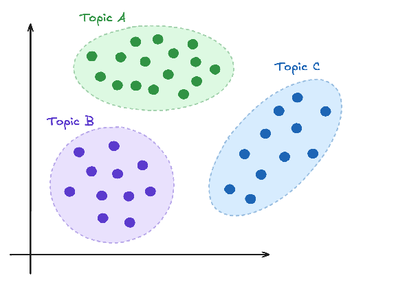

# AI Cost Optimization & LLM Systems Engineering Masterclass

> **Private Tutorial-Grade Reference & Complete Lab Repository**  
> **Course:** [ByteByteGo AI Cost Optimization (Nov 2026 Cohort)](https://learn.bytebytego.com/c/course-ai-cost-optimization-c1/sections/1171130/lessons/4489135) • **Instructor:** Jeremy Hintz (AI Inference Optimization @ Meta)  
> **Upstream Cohort Repo:** [jamoque/bytebytego-ai-cost-optimization-nov-cohort](https://github.com/jamoque/bytebytego-ai-cost-optimization-nov-cohort)



---

## Table of Contents

1. [Executive Summary & The Core Cost Equation](#1-executive-summary--the-core-cost-equation)
2. [Repository Architecture & Navigation Map](#2-repository-architecture--navigation-map)
3. [The End-to-End AI Cost Optimization Stack](#3-the-end-to-end-ai-cost-optimization-stack)
4. [Module-by-Module Curriculum, Videos, Whiteboards & Labs](#4-module-by-module-curriculum-videos-whiteboards--labs)
5. [Verified Benchmark Results & Napkin Math Cheat Sheet](#5-verified-benchmark-results--napkin-math-cheat-sheet)
6. [Quickstart: Running the Labs & Reference Solutions](#6-quickstart-running-the-labs--reference-solutions)
7. [Foundational Papers & Production Engineering References](#7-foundational-papers--production-engineering-references)

---

## 1. Executive Summary & The Core Cost Equation

Every production LLM cost problem decomposes into two multiplicative levers and a quality constraint:

$$\text{Total Inference Cost} = \underbrace{\left(N_{\text{fresh\_in}} + N_{\text{cache\_write}} + N_{\text{cache\_read}} + N_{\text{out}} + N_{\text{reasoning}}\right)}_{\text{Week 1 \& Week 2: Token Volume Engineering}} \times \underbrace{P_{\text{tier}}(\text{model})}_{\text{Week 3 \& Week 4: Price-per-Token Routing}} \quad \text{s.t.} \quad \text{Quality} \ge Q_{\min}$$

When expanded across modern provider billing meters ([Anthropic Pricing](https://platform.claude.com/docs/en/about-claude/pricing), [OpenAI Pricing](https://developers.openai.com/api/docs/pricing)):

$$\text{Request Cost} = N_{\text{fresh\_in}} P_{\text{in}} + N_{\text{cache\_write}} \left(1.25 P_{\text{in}}\right) + N_{\text{cache\_read}} \left(0.10 P_{\text{in}}\right) + \left(N_{\text{out}} + N_{\text{reasoning}}\right) P_{\text{out}}$$

### Why Output Tokens Cost $3\times$ to $5\times$ More Than Input Tokens (GPU Hardware Roofline)
- **Prefill Phase (Compute-Bound GEMM):** Processes all $N$ input tokens in parallel across $L$ transformer layers ($L \approx 70\text{--}100$), saturating GPU tensor cores (~`980 TFLOPS` on an NVIDIA H100) and writing keys/values ($K, V$) into High-Bandwidth Memory (HBM). Governs **Time to First Token (TTFT)**.
- **Decode Phase (Memory-Bandwidth-Bound GEMV):** Generates output and reasoning tokens autoregressively **one token at a time**, streaming model weights ($W_Q, W_K, W_V, W_O$, FFN) and the growing **KV Cache** from HBM (~`3.35 TB/s` on H100) into on-chip SRAM on every step. Governs **Inter-Token Latency (ITL / TPOT)**. Because moving weights from HBM to on-chip ALUs cannot be amortized across parallel tokens during single-request decoding, each output token consumes disproportionately more GPU-seconds:

$$\text{Price per Token} \propto \frac{\text{Amortized } \$ \text{ per GPU-second}}{\text{Tokens processed per GPU-second in phase}}$$

---

## 2. Repository Architecture & Navigation Map

```text
ai-cost-optimization-masterclass/
├── README.md                                              # Master curriculum index, architecture & quickstart
├── tutorials/                                             # Deep-dive textbook chapters & solved Q&A guides
│   ├── 01_Week1_Foundations_Inference_Mechanics_and_Observability.md
│   ├── 02_Week2_Semantic_Caching_Workflow_Compilation_and_Context_OS.md
│   ├── 03_Week3_Intelligent_Routing_Model_Cascades_and_Agentic_Systems.md
│   └── 04_Lab_Solutions_Benchmarks_and_Transcript_QA_Index.md
├── assets/
│   ├── diagrams/                                          # Extracted lab architecture, MF router & vector SVGs
│   │   ├── architecture_01_week1_mesh_kv.svg              # Week 1 LLM Mesh + KV Cache architecture SVG
│   │   ├── architecture_02_week2_semantic_cache_context_os.svg
│   │   ├── architecture_03_week3_routing_agents.svg
│   │   ├── lab1_image1.png                                # Lab 1 LLM Mesh + Langfuse architecture
│   │   ├── lab3_image1.png                                # Lab 3 Token Count vs. Price per Token matrix
│   │   ├── lab3_image2.png                                # Lab 3 Multi-Tier Routing & Agent Desk architecture
│   │   ├── lab3_image3.png                                # Lab 3 PyTorch Matrix Factorization Router architecture
│   │   └── lesson2_embedded_1..7.png                      # Lesson 2 Excalidraw embedded diagrams
│   └── whiteboards/                                       # Full high-resolution rendered Excalidraw whiteboards
│       ├── lesson1_foundations_whiteboard.png
│       ├── lesson2_caching_compression_whiteboard.png
│       └── lesson3_routing_cascades_whiteboard.png
├── lesson1/                                               # Week 1: AI Cost Dynamics, Observability & Prefix Caching
│   ├── lecture/prompt-caching-demo/                       # Live API prefix-cache latency & cost experiment
│   └── lab/
│       ├── README.md                                      # Cleaned GitHub-native Lab 1 Specification
│       ├── llm-mesh-lab/                                  # LiteLLM Proxy + Langfuse OTel mesh configuration
│       └── prompt-caching-lab/                            # From-scratch Chained-Hash PrefixCache engine + pytest
├── lesson2/                                               # Week 2: Semantic Caching, RAG & Context Compression
│   ├── lecture/semantic-caching-demo/                     # Sentence-Transformers vector clustering demo
│   └── lab/
│       ├── README.md                                      # Cleaned GitHub-native Lab 2 Specification
│       ├── rag-lab/                                       # Northstar Commerce RAG + LiteLLM Qdrant Semantic Cache
│       └── context-os-lab/                                # From-scratch Context OS (Chunk, RAG, Cache, Compress, Compact)
└── lesson3/                                               # Week 3: Intelligent Routing, Model Cascades & Agent Workflows
    └── lab/
        ├── README.md                                      # Cleaned GitHub-native Lab 3 Specification
        ├── routing-lab/                                   # 6-Arm Routing + ReAct/Plan/Supervisor Agent Desk
        └── mf-router-lab/                                 # PyTorch Matrix Factorization Router trained on 307 battles
```

---

## 3. The End-to-End AI Cost Optimization Stack

| Layer | Optimization Technique | Target Lever | Typical Savings | Quality Impact | Code Implementation |
| :--- | :--- | :--- | :--- | :--- | :--- |
| **0. Control Plane** | **LLM Mesh & OTel Attribution** ([LiteLLM](https://docs.litellm.ai/docs/simple_proxy) + [Langfuse](https://langfuse.com/integrations/gateways/litellm)) | Visibility & Governance | Identifies top 20% features driving 80% spend | Zero loss (pure observability) | [`lesson1/lab/llm-mesh-lab/config.yaml`](lesson1/lab/llm-mesh-lab/config.yaml) |
| **1. Hardware KV** | **Prefix / Prompt Caching** ([Anthropic Prompt Caching](https://platform.claude.com/docs/en/build-with-claude/prompt-caching)) | $P_{\text{read}} = 0.10 P_{\text{in}}$ on static prefix blocks | **70%–75.1%** input cost; **73.3%** Turn 2+ latency cut | **Bit-for-bit lossless** | [`lesson1/lab/prompt-caching-lab/prompt_cache.py`](lesson1/lab/prompt-caching-lab/prompt_cache.py) |
| **2. Gateway Cache** | **Semantic Caching** ([LiteLLM Semantic Cache](https://docs.litellm.ai/docs/proxy/caching_semantic) + Qdrant) | Zero upstream tokens ($\text{llm\_calls}=0$) on paraphrase hits | **Near 100%** on hits (`$0.000003`/req embed vs. `$0.011`/req) | Controlled via threshold (`0.80`) + LLM-as-Judge canary | [`lesson2/lab/rag-lab/mesh_config.yaml`](lesson2/lab/rag-lab/mesh_config.yaml) |
| **3. Retrieval** | **Top-$k$ Overlapping RAG vs. Corpus Stuffing** ([Chroma](https://docs.trychroma.com/docs/collections/configure)) | Shrinks KB tokens sent per request | **83.7%** prompt token cut vs. full-corpus stuffing | Improves signal-to-noise (mitigates [Context Rot](https://www.trychroma.com/research/context-rot)) | [`lesson2/lab/rag-lab/index_kb.py`](lesson2/lab/rag-lab/index_kb.py) |
| **4. Context OS** | **Extractive Compression + History Compaction + Fact Memory** | Caps retrieved chunks (`120t`) & history (`400t`) | **93.9%** multi-turn token & cost reduction | Fact store (`mode="memory"`) preserves Turn 1 IDs | [`lesson2/lab/context-os-lab/context_os.py`](lesson2/lab/context-os-lab/context_os.py) |
| **5. Model Routing** | **Rules (`mesh-auto`), Semantic Routes, [FrugalGPT Cascade](https://arxiv.org/abs/2305.05176), [RouteLLM MF](https://arxiv.org/abs/2406.18665)** | Shifts easy queries from `$3/$15` Strong to `$0.15/$0.60` Weak | **70%–85%** cost reduction at 95%+ strong quality | Calibrated via `calibrate.py` & domain battles (AUC `0.73`) | [`lesson3/lab/routing-lab/routing.py`](lesson3/lab/routing-lab/routing.py) & [`mf_router.py`](lesson3/lab/mf-router-lab/mf_router.py) |
| **6. Agentic Flows** | **Plan-and-Execute, Specialist Teams, Re-Tiering & [vLLM SAAR](https://vllm.ai/blog/2026-07-21-vllm-sr-new-chapter-mom)** | Isolates worker contexts & pins tool loops to preserve KV cache | **40%–80%** multi-agent workflow savings | High when planner/billing stay on strong/mid tiers | [`lesson3/lab/routing-lab/agents.py`](lesson3/lab/routing-lab/agents.py) |

---

## 4. Module-by-Module Curriculum, Videos, Whiteboards & Labs

| Module | Video Recording & Transcript | Whiteboard & SVG Exports | Hands-On Lab & Deep-Dive Tutorial |
| :--- | :--- | :--- | :--- |
| **Week 1 Live Session** (Sat, Oct 31 • `02:54:29`) | `../01_Week1_Live_Session_2026-10-31_AI_Cost_Dynamics_and_Observability.mp4` + `../Week-1-Transcript.vtt` | `../Lesson 1_ Foundations.excalidraw` ([Excalidraw Link](https://app.excalidraw.com/s/9RJPFj46K45/5JdnYUPzDL5)) | [Tutorial 01](tutorials/01_Week1_Foundations_Inference_Mechanics_and_Observability.md) • [Lab 1 README](lesson1/lab/README.md) |
| **Week 1 Office Hour** (Tue, Nov 3 • `58:24`) | `../02_Week1_Office_Hour_2026-11-03_AI_Cost_Dynamics_and_Observability.mp4` + `../Week-1-Transcript-Office-Hours.vtt` | Covered in Tutorial 01 & Q&A Index | [Tutorial 04 (Q&A Index)](tutorials/04_Lab_Solutions_Benchmarks_and_Transcript_QA_Index.md) |
| **Week 2 Live Session** (Sat, Nov 7 • `02:07:44`) | `../03_Week2_Live_Session_2026-11-07_Token_Efficiency_Techniques.mp4` + `../Week-2-Transcript.vtt` | `../Lesson 2_ Caching & Compression.excalidraw` ([Excalidraw Link](https://link.excalidraw.com/l/9RJPFj46K45/5rjUHd25pKl)) | [Tutorial 02](tutorials/02_Week2_Semantic_Caching_Workflow_Compilation_and_Context_OS.md) • [Lab 2 README](lesson2/lab/README.md) |
| **Week 2 Office Hour** (Tue, Nov 10 • `22:28`) | `../04_Week2_Office_Hour_2026-11-10_Token_Efficiency_Techniques.mp4` + `../Week-2-Transcript-Office-Hours.vtt` | Covered in Tutorial 02 & Q&A Index | [Tutorial 04 (Q&A Index)](tutorials/04_Lab_Solutions_Benchmarks_and_Transcript_QA_Index.md) |
| **Week 3 Live Session** (Sat, Nov 14 • `02:14:42`) | `../05_Week3_Live_Session_2026-11-14_Intelligent_Routing_and_Model_Cascades.mp4` + `../Week-3-Transcript.vtt` | `../Lesson 3_ Routing and Model Cascades.excalidraw` ([Excalidraw Link](https://app.excalidraw.com/s/9RJPFj46K45/2Kz4F3debdg)) | [Tutorial 03](tutorials/03_Week3_Intelligent_Routing_Model_Cascades_and_Agentic_Systems.md) • [Lab 3 README](lesson3/lab/README.md) |

---

## 5. Verified Benchmark Results & Napkin Math Cheat Sheet

### A. Lab 1 Cross-Provider Telemetry (5 Identical Prompts via LiteLLM Mesh)
| Metric | Provider A (`mesh-gpt-mini` / `gpt-4o-mini`) | Provider B (`mesh-claude-haiku` / `claude-haiku-4-5`) | Frontier Tier (`mesh-claude-sonnet` / `claude-sonnet-4-6`) |
| :--- | :--- | :--- | :--- |
| **Published Unit Price (Input / Output per 1M)** | `$0.15` / `$0.60` | `$1.00` / `$5.00` | `$3.00` / `$15.00` |
| **Total Cost (5 requests)** | `$0.000226` | `$0.002260` (**$10\times$ higher**) | `$0.0068+` (**$20\text{--}30\times$ higher**) |
| **Avg Input Tokens (Tokenizer Delta)** | `21` tokens | `23` tokens (`+9.5%` BPE delta) | `23` tokens |
| **Avg Output Tokens (Verbosity Delta)** | `70` tokens | `~81` tokens (`+15.7%` verbosity) | Workload-dependent |
| **Avg End-to-End Latency** | `2.08s` | `1.65s` (`20.7%` faster) | Higher TTFT / TPOT |

### B. Lab 1 Chained-Hash `PrefixCache` Simulation (`lesson1/lab/prompt-caching-lab/run_demo.py --no-sleep`)
- **Static Prefix:** `~11,694` tokens (`system_prompt.txt` + `tools.json` + `reference_document.txt`), **Block Size:** `64` tokens, **Min Cacheable:** `1,024` tokens, **TTL:** `300s`.
- **Arm A (Uncached Baseline, 8 Turns):** `$0.287319` total cost, `0.729s` mean latency (`0.730s` on Turns 2–8).
- **Arm B (`PrefixCache` Enabled, 8 Turns):** Turn 1 incurs a write spike (`11,712` created tokens, `$0.043989` vs. `$0.035205` baseline due to the $1.25\times$ write surcharge), while Turns 2–8 achieve **99.1%–99.2% cache hit rate** (`$0.003841`–`$0.003986`/turn), reducing total 8-turn cost to `$0.071453` (**`75.1%` input cost reduction**) and Turn 2+ latency to `0.195s` (**`73.3%` latency improvement**).

### C. Lab 2 `ContextOS` Four-Arm Simulation (`lesson2/lab/context-os-lab/run_demo.py --no-sleep`)
- **Workload 1 (8 Single-Shot Queries with Paraphrases):**
  - `Arm A (Stuffing)`: `2,698` prompt tokens, `8` LLM calls, `$0.008094`
  - `Arm B (Top-k RAG only)`: `441` prompt tokens (**`-83.7%`**), `8` LLM calls, `$0.001323`
  - `Arm C (RAG + Semantic Cache)`: `329` prompt tokens, `6` LLM calls (`2` paraphrase hits with `0` tokens billed), `$0.000987`
  - `Arm D (Full Pipeline: RAG + Cache + Extractive Compression)`: `278` prompt tokens (**`-89.7%`**), `6` LLM calls, `$0.000834`
- **Workload 2 (8-Turn Multi-Topic Support Conversation):**
  - `Arm A (Stuffing, No Compaction)`: Prompt grows linearly from `345` to `2,757` tokens (`12,404` cumulative tokens, `$0.037212`, `0.114s` mean latency).
  - `Arm D (Full Pipeline with 120-Token Compaction Budget)`: Prompt stays bounded between `54` and `119` tokens (`755` cumulative tokens, `$0.002265`, `0.041s` mean latency) — a **`93.9%` reduction in prompt tokens and cost**.

### D. Lab 3 PyTorch Matrix Factorization Router (`lesson3/lab/mf-router-lab/train.py`)
- **Dataset:** `fixtures/battles.json` (`307` judged Northstar policy battles between `gpt-4o-mini` and `claude-sonnet-4-6`; strong model won `72` [`23.5%`], `235` tied).
- **Held-Out 5-Fold Cross-Validation AUC:** Published RouteLLM checkpoint (`routellm/mf_gpt4_augmented` trained on [LMSYS Arena 55k](https://huggingface.co/datasets/lmsys/lmsys-arena-human-preference-55k)) achieves **AUC `0.60`** (catching `44%` of strong wins at a `30%` strong budget), whereas our domain-trained bilinear MF router (`MFModel`: $1536 \to 128$ projection) achieves **AUC `0.68–0.73`** (catching **`56%`** of strong wins at the same `30%` budget).

---

## 6. Quickstart: Running the Labs & Reference Solutions

### Run All Offline Unit Tests & Reference Demos (Zero API Keys or Spend Required)

```bash
# 1. Lab 1: Prompt Caching Engine From Scratch
cd lesson1/lab/prompt-caching-lab
PYTHONPATH=. pytest -v

# 2. Lab 2: Context OS (Chunking, Cosine RAG, Semantic Cache, Compression, Compaction)
cd ../../../lesson2/lab/context-os-lab
PYTHONPATH=. pytest -v

# 3. Lab 3: PyTorch Matrix Factorization Router
cd ../../../lesson3/lab/mf-router-lab
PYTHONPATH=. pytest -v
```

---

## 7. Foundational Papers & Production Engineering References

- **Gateways & Observability:** [LiteLLM Proxy Docs](https://docs.litellm.ai/docs/simple_proxy) • [LiteLLM Auto Routing](https://docs.litellm.ai/docs/proxy/auto_routing) • [LiteLLM Semantic Caching](https://docs.litellm.ai/docs/proxy/caching_semantic) • [Langfuse LiteLLM Integration](https://langfuse.com/integrations/gateways/litellm) • [Langfuse Tracing Data Model](https://langfuse.com/docs/tracing)
- **KV & Prefix Caching:** [Anthropic Prompt Caching](https://platform.claude.com/docs/en/build-with-claude/prompt-caching) • [Prompt Cache: Modular Attention Reuse (arXiv:2311.04934)](https://arxiv.org/pdf/2311.04934) • [PagedAttention / vLLM (arXiv:2309.06180)](https://arxiv.org/pdf/2309.06180)
- **Context Rot, Embeddings & RAG:** [Chroma Technical Report: Context Rot](https://www.trychroma.com/research/context-rot) • [Chroma Cosine Collections](https://docs.trychroma.com/docs/collections/configure) • [Sentence-Transformers all-MiniLM-L6-v2](https://huggingface.co/sentence-transformers/all-MiniLM-L6-v2) • [MongoDB/voyage-code-3](https://huggingface.co/MongoDB/voyage-code-3) • [Codebase Retrieval Paper (arXiv:2605.15184v1)](https://arxiv.org/html/2605.15184v1)
- **Model Cascades & Routing:** [FrugalGPT (arXiv:2305.05176)](https://arxiv.org/abs/2305.05176) • [RouteLLM (arXiv:2406.18665)](https://arxiv.org/abs/2406.18665) • [RouteLLM GitHub](https://github.com/lm-sys/RouteLLM) • [vLLM Semantic Router & Mixture of Models](https://vllm.ai/blog/2026-07-21-vllm-sr-new-chapter-mom) • [Oracle Convergence & Routing Limits (arXiv:2602.03478)](https://arxiv.org/pdf/2602.03478) • [Semantic Router Library](https://github.com/aurelio-labs/semantic-router)
- **Agentic Workflows:** [Anthropic Engineering: Building Effective Agents](https://www.anthropic.com/engineering/building-effective-agents) • [Oracle Developers: What is the AI Agent Loop?](https://blogs.oracle.com/developers/what-is-the-ai-agent-loop-the-core-architecture-behind-autonomous-ai-systems)
