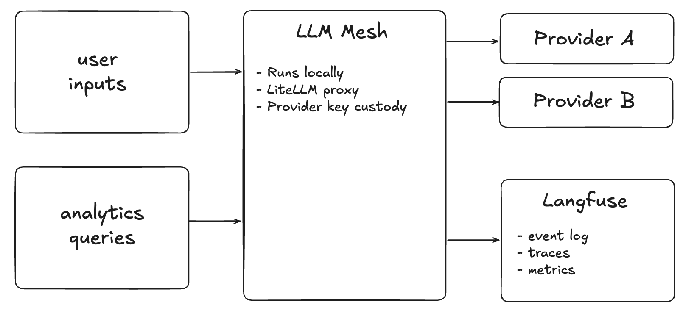

# Lab 1: LLM Mesh + Observability + Prompt Caching

**Course:** ByteByteGo AI Cost Optimization - Nov Cohort | **Instructor**: Jeremy Hintz  
**Estimated time to complete:** 90-120 minutes

## 1. Purpose

In lecture we saw that agentic LLM workloads re-purchase their context on every step, and that costs amplify through retries, fan-out, and tool-schema bloat. None of that can be *managed* until it can be *observed*. Observation requires every application to talk to every provider directly through its own SDK, its own keys, and its own (sometimes nonexistent and fragmented) logging.

An **LLM Mesh** (also called an LLM gateway or AI gateway) solves this by putting a single control plane between your applications and your model providers:

- **One API surface**: every app speaks the same language to the gateway, regardless of which provider actually serves the request  
- **Centralized key and access management**: provider keys live in one place  
- **Routing and aliasing**: "cheap fast model" can become a name the mesh resolves independently, making it easier to swap providers later on (we will look at this piece much more deeply later in the course)  
- **A single choke point for observability**: every token flows through one place where it can be traced, metered, and logged

In this lab you will stand up a working mesh in front of **two providers**, then instrument it with **Langfuse** so that every request produces raw events, metrics, logs, and traces you can analyze. 

You'll finish by setting up prompt caching in your API requests.

## 2. Learning Objectives

By the end of this lab, you will be able to:

1. **Explain** the role of an LLM mesh/gateway in a cost-optimization strategy  
2. **Deploy** LiteLLM Proxy locally and register two independent providers behind one endpoint  
3. **Route** identical client code to different providers purely through mesh configuration  
4. **Instrument** the mesh with Langfuse and identify where each of the four observability pillars lives: raw events, metrics, logs, and traces  
5. **Analyze** real telemetry (cost per request, token counts, latency) across two providers  
6. **Optimize** by adding prompt caching to provider API requests

   

    

## 3. Architecture



## 4. Prerequisites

Before starting the timed portion, make sure you have:

- **Installed Python 3.10+** and the ability to create a virtual environment.  
- **Obtain 2+ provider API keys.** The reference materials and configurations in this lab will use **OpenAI** and **Anthropic**. If you don't have paid accounts or prefer other providers, please go ahead! LiteLLM supports all of them, you'll just adjust the provider prefix in the config.   
  - How-To Guides:  
    - Anthropic → [https\://platform.claude.com/docs/en/get-api-key](https://platform.claude.com/docs/en/get-api-key)   
    - OpenAI → [https\://developers.openai.com/api/docs/quickstart](https://developers.openai.com/api/docs/quickstart)   
  - ⚠️ **Note**: **Under \$1** expected spend if you use paid keys and small models  
  - ⚠️ **Important Reminder:** provider keys should be stored as as local environment variables. Please please please. It’s easy to accidentally and commit / push an API key. Don’t do it!  
- **Create a free Langfuse Cloud account**: sign up at https\://cloud.langfuse.com (Hobby tier is sufficient). Self-hosting Langfuse via Docker is also great!

> 

## 5. A Note on Using AI 

Like many (most) things these days, using AI (Claude Code, Cursor, etc) will probably knock this exercise out at break-neck speed. That may or may not be the best way to actually learn something, depending on the person. If you want to use AI to write the code for this lab, go for it! But I encourage you to reason about the code itself and try to understand the ideas. This isn’t for a grade or anything, it’s purely for you to learn.

## Part 1: Install and Configure the Mesh (~25 min)

### 1.1 Set up the project and install LiteLLM

This directory already exists in the cloned repo:

```bash
cd lesson1/lab/llm-mesh-lab
python -m venv .venv && source .venv/bin/activate   # Windows: .venv\Scripts\activate
pip install 'litellm[proxy]'
pip install openai
```

### 1.2 Export your provider keys

| \$ export OPENAI\_API\_KEY="sk-..." \$ export ANTHROPIC\_API\_KEY="sk-ant-..." |
| :---- |

⚠️ Reminder: DO NOT COMMIT THESE! :)

### 1.3 Write the mesh configuration

A starter `config.yaml` is already in this directory. Confirm it looks like:

| model\_list:   \# ---- Provider A: OpenAI ----   - model\_name: mesh-gpt-mini                     \# your own alias; feel free to change     litellm\_params:       model: openai/gpt-4o-mini                   \# model to proxy; feel free to change       api\_key: os.environ/OPENAI\_API\_KEY   \# ---- Provider B: Anthropic ----   - model\_name: mesh-claude-haiku     litellm\_params:       model: anthropic/claude-haiku-4-5-20251001       api\_key: os.environ/ANTHROPIC\_API\_KEY general\_settings:   master\_key: sk-mesh-lab-1234                    \# client \<\> mesh auth  |
| :---- |

### 

### 1.4 Start the mesh

| \$ litellm --config config.yaml |
| :---- |

You should see the proxy start on http\://0.0.0.0:4000.

### 1.5 Verify

In a second terminal window, ask the mesh what models it exposes:

| \$ curl http\://localhost:4000/v1/models -H "Authorization: Bearer sk-mesh-lab-1234" |
| :---- |

**Checkpoint 1:** the response should list your two aliases (mesh-gpt-mini, mesh-claude-haiku) and *only* aliases, no provider model IDs.

**Don't be fooled if you see "owned\_by": "openai" on both entries.** The list endpoint reveals both are following OpenAI-*protocol* facade: LiteLLM hardcodes `owned_by` to `"openai"` and stamps every entry with the same placeholder created timestamp (1677610602), purely for compatibility with clients that expect OpenAI's response shape. Said otherwise, provider identity is deliberately not part of the client-facing contract.

If you want to confirm:

| \$ curl http\://localhost:4000/v1/models/mesh-claude-haiku -H "Authorization: Bearer sk-mesh-lab-1234" \# → "owned\_by": "anthropic" |
| :---- |

## Part 2: Route Traffic Through the Mesh (~15 min)

### 2.1 Call Provider A with curl

| curl http\://localhost:4000/v1/chat/completions \\   -H "Authorization: Bearer sk-mesh-lab-1234" \\   -H "Content-Type: application/json" \\   -d '{     "model": "mesh-gpt-mini",     "messages": \[{"role": "user", "content": "In one sentence, what is a KV cache?"}\]   }' |
| :---- |

### 2.2 Call Provider B by changing one string

Re-run the same command, swapping the model param

### 2.3 Do it from Python with the plain OpenAI SDK

A starter `client_test.py` is already in this directory:

| from openai import OpenAI QUESTION \= "What is the capital of France?" \# Note: this is the STANDARD OpenAI Protocol SDK client \= OpenAI(     base\_url="http\://localhost:4000/v1",     api\_key="sk-mesh-lab-1234", ) |
| :---- |

Write code to loop through the model aliases and print the answer to QUESTION for each.

**✅ Checkpoint 2:** both aliases respond through the unmodified OpenAI SDK.

**🤔Think:** Your client passed `api_key="sk-mesh-lab-1234"` and it worked for both OpenAI and an Anthropic model. Trace the two authentication hops that actually occurred. Why might splitting auth this way be beneficial for e.g. (a) offboarding an employee (b) capping a team's monthly spend?

## Part 3: Wire Up Observability with Langfuse (~30 min)

### 3.1 Get Langfuse credentials

1. Log in to Langfuse Cloud and create a project (e.g., llm-mesh-lab).  
2. In **Project Settings → API Keys**, create a key pair. You'll get a **public key** (pk-lf-...) and a **secret key** (sk-lf-...).

### 3.2 Export them and point at your data region

| \$ export LANGFUSE\_PUBLIC\_KEY="pk-lf-..." \$ export LANGFUSE\_SECRET\_KEY="sk-lf-..." \$ export LANGFUSE\_OTEL\_HOST="https\://us.cloud.langfuse.com"       \# assuming US region  |
| :---- |

### 3.3 Enable the callback in the mesh config

Add to `config.yaml`:

| litellm\_settings:   callbacks: \["langfuse\_otel"\] |
| :---- |

This uses LiteLLM's OpenTelemetry-based Langfuse integration: every request through the mesh is exported as an OTel trace to Langfuse, carrying the request/response payloads, token usage, timing, and any metadata you attach. 

Note what we did **not** do: you did not touch client\_test.py. Instrumentation at the mesh means every current and future client is observed for free.

### 3.4 Restart the mesh and generate labeled traffic

Stop the proxy (Ctrl+C) and start it again with the same command. Then create [`workload.py`](http://workload.py):

| import time from openai import OpenAI client \= OpenAI(base\_url="http\://localhost:4000/v1", api\_key="sk-mesh-lab-1234") PROMPTS \= \[     "Summarize in 2 sentences why prefix caching lowers LLM inference cost.",     "Explain the difference between prefill and decode in one short paragraph.",     "List 3 reasons an agent's context grows across steps. Be brief.",     "What is speculative decoding? Answer in under 50 words.",     "Why is output pricing usually higher than input pricing? 2 sentences.", \] for alias in \["mesh-gpt-mini", "mesh-claude-haiku"\]:     for i, prompt in enumerate(PROMPTS):         t0 \= time.time()         resp \= client.chat.completions.create(             model=alias,             messages=\[{"role": "user", "content": prompt}\],             \# Metadata flows through the mesh into Langfuse:             extra\_body={                 "metadata": {                     "generation\_name": f"lab4-q{i}",                     "session\_id": "lab1-cost-experiment",                     "tags": \["lab1", alias\],                 }             },         )         print(f"{alias} q{i}: {time.time()-t0:.2f}s, "               f"{resp.usage.prompt\_tokens}+{resp.usage.completion\_tokens} tokens")  |
| :---- |

### 

Run it: `python workload.py` (10 requests total; give Langfuse ~30–60 seconds to ingest).

### 3.5 Tour the four pillars in the Langfuse UI

Open your project and find each of the following. This mapping is the conceptual core of the lab — every observability stack you'll ever meet (Datadog, Grafana, OTel collectors) has some version of these four:

|  | Where you'll find it | What to look at |
| :---- | :---- | :---- |
| **Traces** | **Tracing → Traces** | One trace per request. Open one: the tree of observations, the generation span, its duration. In a multi-step agent, one trace would contain *many* generations — here each trace has one. |
| **Raw events** | Inside a trace → click the **generation** | The raw ingested record: exact input messages, exact model output, model name, parameters, token usage. This is the ground-truth event from which everything else is derived. |
| **Metrics** | **Dashboards**  (and the trace table columns) | Aggregates over events: total cost, cost per model, token counts, latency percentiles, request volume over time. |
| **Logs** | The **Traces table**  (filterable, chronological request record)  | Langfuse's trace list *is* your request log: filter by tag `lab4`, by model, by error status. The proxy's stdout gives you the infrastructure-level log line per request. |

**✅ Checkpoint 3:** Screenshot (a) the trace list filtered to tag `lab4`, (b) one opened trace showing a generation with input/output and token usage, and (c) a dashboard view showing **cost broken down by model**.

**📝 Question 3:** Your `workload.py` sent `session_id` and `tags` through the mesh. Explain how you would use exactly these two fields to answer, six months from now: *"Which product feature is responsible for 80% of our LLM spend?"* What would you need to enforce at the mesh for that query to stay answerable?

**📝 Question 4:** Distinguish a *trace* from a *raw event* from a *metric* using your own screenshots as evidence: point to one concrete number in your dashboard and walk it back to the raw event(s) it was computed from.

---

## Part 4: The Cost Experiment (~20 min)

You now have 5 identical prompts answered by two providers, with full telemetry. Act like a cost engineer.

### 4.1 Build a comparison table

From Langfuse (trace table + generation details), fill in:

|  | Provider A (mesh-gpt-mini) | Provider B (mesh-claude-haiku) |
| :---- | :---- | :---- |
| Total cost (5 requests) |  |  |
| Avg input tokens |  |  |
| Avg output tokens |  |  |
| Avg latency |  |  |
| Cost per 1K output tokens (effective) |  |  |

### 4.2 Food for Thought Questions

**🤔 Question 1:** Identical prompts rarely produce identical token counts across providers. Where did the difference come from in your data, input side (tokenization) or output side (verbosity)? Which one is more under your control, and how?

**🤔 Question 2:** Based only on your table above, what would be your routing recommendation for this workload class (i.e. short Q\&A, low stakes). What measurements does your experiment *not* capture that could reverse your recommendation?

## References

- LiteLLM Proxy docs: [https\://docs.litellm.ai/docs/simple\_proxy](https://docs.litellm.ai/docs/simple_proxy)  
- LiteLLM ↔ Langfuse logging: [https\://docs.litellm.ai/docs/proxy/logging](https://docs.litellm.ai/docs/proxy/logging)  
- Langfuse ↔ LiteLLM integration guide: [https\://langfuse.com/integrations/gateways/litellm](https://langfuse.com/integrations/gateways/litellm)  
- Langfuse tracing data model: [https\://langfuse.com/docs/tracing](https://langfuse.com/docs/tracing)

## 

## 

## Advanced Exercise: Build a Prompt Caching Engine From Scratch

During lecture, we ran a black-boxed experiment that showed the power of simple prompt caching for decreasing costs from API providers. We saw Anthropic's API report cache\_creation\_input\_tokens and cache\_read\_input\_tokens, and confirmed that caching a large static prefix slashes cost and latency on later turns.

This exercise goes inside that black-box: you implement the caching engine itself and make it reproduce the create / read / fresh accounting you observed against the real API: no API key, no network, no spend.

### Learning objectives

By the end you will be able to explain, from first principles:

1. Why prompt caching is prefix-based and block-aligned, and why a single changed byte near the start invalidates the cache for everything after it.  
2. How a chained hash lets a server match the longest cached prefix in O(blocks).  
3. Why the cache is ephemeral (TTL) and why reads refresh the TTL.  
4. How a bounded cache uses LRU eviction under memory pressure.

### The mental model

- Caching works in fixed-size **blocks**. Only complete blocks are cacheable; the trailing partial block is re-processed every time.  
- Each block gets a **chained hash**: hash(prev\_hash + block\_tokens), so a block only matches when the entire prefix is identical.  
- Per request: find the longest run of leading blocks already cached (**read**/hit), write the new blocks after it (**create**/write), and the leftover tail is **fresh**.  
- Entries **expire** after a TTL; a hit **slides** the TTL forward.  
- When blocks exceed the budget, the **least-recently-used** ones are evicted.

### Your task

1. Navigate to [https://github.com/jamoque/bytebytego-ai-cost-optimization-nov-cohort](https://github.com/jamoque/bytebytego-ai-cost-optimization-nov-cohort)   
2. Clone the repository  
3. Edit only `lesson1/lab/prompt-caching-lab/prompt_cache.py`. Implement the five methods marked TODO, in order:  
   

| Function | Purpose |
| :---- | :---- |
| PrefixCache.\_block\_hashes | Split tokens into complete blocks; assign prefix-dependent chained hashes |
| PrefixCache.lookup | Count contiguous leading blocks that are cached and unexpired |
| PrefixCache.store | Write new blocks; refresh the TTL of hits; trigger eviction |
| PrefixCache.\_evict | Drop least-recently-used blocks until under max\_blocks |
| PrefixCache.process | Tie it together: accounting for read / write / fresh + cost |

Everything else is provided: the tokenizer, dataclasses, and pricing constants. Each function has a detailed docstring spelling out the contract.

### Workflow

```bash
cd lesson1/lab/prompt-caching-lab
python -m venv .venv && source .venv/bin/activate   # or reuse the parent venv
pip install -r requirements.txt

# 1. Implement the TODOs in prompt_cache.py, checking your work as you go:
pytest -v

# 2. Once green, watch your engine reproduce the lecture demo's 8-turn run:
python run_demo.py   # add --no-sleep to skip the latency simulation
```

A correct implementation prints a table where turn 1 is a big **write** and turns 2-8 are ~99% **reads**, with a cost reduction in the 70%+ range — the same shape you saw against the live API.

### Definition of done

1. All tests in test\_prompt\_cache.py pass (pytest -v).  
2. python run\_demo.py shows turn-1 create spike, turns 2–8 dominated by reads.  
3. You can explain why turn 1 with caching is *more* expensive than baseline.

If you run out of gas or just want to run a completed solution, you can find the solution in reference\_solution.py

### References

- Anthropic prompt caching docs: [https\://platform.claude.com/docs/en/build-with-claude/prompt-caching](https://platform.claude.com/docs/en/build-with-claude/prompt-caching)  
- Demo experiment: [../lecture/prompt-caching-demo/README.md](../lecture/prompt-caching-demo/README.md)

