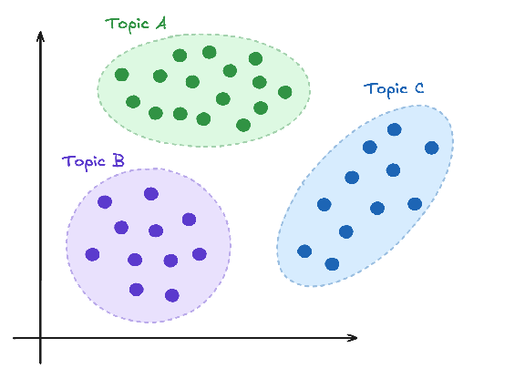
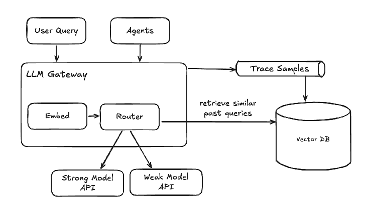
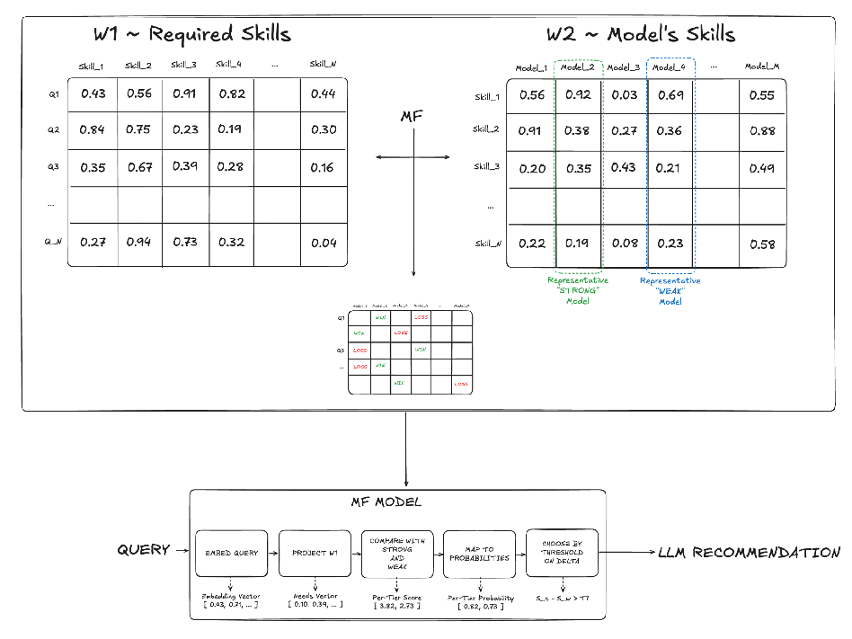

# Lab 3: Model Routing + Agent Workflow Optimization + Agentic Routing

**Course:** ByteByteGo AI Cost Optimization - Nov Cohort | **Instructor**: Jeremy Hintz  
**Estimated time to complete:** 90-120 minutes

## 1. Purpose

In the very first lecture we framed the tokenomics of LLM inference as (number of tokens) x (price per token).

The previous labs explored techniques for optimizing the **number of tokens**: ways we could make each model API request smaller: prompt caching, semantic caching, compressing and compacting the context window, and structuring memory for smart retrieval. This lab approaches the other dimension: **price per token**. The per-token cost of strong models and relatively weaker models varies drastically. In this lab, we’ll explore routing across a strong and weak model, where the strong model costs ~20x the weak one… so routing intelligently is going to be essential for managing our costs.

The topics in this lab will cover:

* **Model routing**: deciding which model answers each request. We’ll step through three variants of increasing sophistication and complexity: **deterministic** (rules in the gateway, embedding routes in the client), a **model cascade** (cheap first, escalate on doubt), and **preference-based** routing with RouteLLM.

* **Agent workflow optimization**: an agent re-reads its whole context on every step. **Planning** buys the expensive model once and executes on cheap ones in fresh contexts. **Memory** optimizes for doing better than straight up dropping facts during compaction, like we saw happen in Lab 2.

* **Agentic routing**: in a multi-agent system the routing decision moves from "which model answers this question" to "which agent handles this sub-task", and each agent brings its own model, tools, and slice of the knowledge base

This lab is intended to build on top of everything we have built so far. Every model call still goes through the LiteLLM mesh you built in Lab 1,with each routing decision traced and instrumented. We will also use Lab 2's index and embedding pipeline over the same Northstar Commerce knowledge base. The embedding model that powered Lab 2's semantic cache will now also be used to map prompts to clusters to make routing decisions.



**Every experiment in this lab denotes the accuracy and cost.** While caching and compression return the same answer for less money, routing often returns a different answer. Even if we save some money, a routing decision made without a quality dimension is not sufficient for a production deployment.

## 2. Learning Objectives

By the end of this lab, you will be able to:

1. **Explain** how model routers can help us optimize for both cost and quality of the responses coming from our system  
2. **Run multiple routing schemes:** deterministic, cascade, and preference-based  
3. **Compare** a single tool-calling agent to plan-and-execute, and reason about how each one spends its tokens  
4. **Route** sub-tasks to specialist agents with an LLM supervisor and with a vector supervisor, then re-calibrate a specialist using measured results

## 3. Architecture



The price ladder (USD per million tokens, input / output):

| Tier | Mesh alias | Model | Price |
| :---- | :---- | :---- | :---- |
| weak | mesh-gpt-mini (Lab 1\) | gpt-4o-mini | \$0.15 / \$0.60 |
| mid | mesh-claude-haiku (Lab 1\) | claude-haiku-4-5 | \$1.00 / \$5.00 |
| strong | mesh-claude-sonnet (new) | claude-sonnet-4-6 | \$3.00 / \$15.00 |

Cost in this lab is read from the mesh: LiteLLM returns an x-litellm-response-cost header on every response, the same number Langfuse shows. The prices in config.yaml are only a fallback for models LiteLLM has no price for.

## 4. Prerequisites

Before starting the timed portion, make sure you have:

- **Completed Lab 1 & 2:** LiteLLM proxy from lesson1/lab/llm-mesh-lab. Vector DB scaffold in lesson2/lab/rag-lab/.chroma/ exists with the default chunking. This lab reads from that index.  
- **API Provider Keys:** OPENAI\_API\_KEY serves the weak tier. ANTHROPIC\_API\_KEY serves the medium and strong tiers.  
- **Installed Python 3.10+** and the ability to create a virtual environment. (This lab was verified on Python 3.14 with routellm 0.2.0.)  
- **LiteLLM recent enough for `mesh-auto`.** Lab 3's gateway router uses `auto_router/complexity_router`, which needs LiteLLM **≥ 1.94**. If you installed LiteLLM during Lab 1 weeks ago, upgrade the Lab 1 venv before starting the mesh: `pip install -U 'litellm[proxy]'`.  
- **Langfuse is optional but useful.** If you wired langfuse\_otel in Lab 1, uncomment that callback in mesh\_config.yaml. Every call in this lab is tagged lab3 along with additional metadata for routing-strategy, tier, and agent info.

⚠️ **Spend:** this lab uses a frontier-class model, so it costs slightly more than Labs 1 and 2. One full run of run\_experiment.py should cost about **\$0.50** as of when this lab was written (November 2026). Budget **\$1-2** for the whole lab.

**Mileage will vary.** Models are not perfectly repeatable even at temperature 0. Between two of our own runs the weak tier's score on the 32-question workload moved by a few questions. The trends around the cost structure should be stable, but individual answers may not be.

## 5. A Note on Using AI

Like many (most) things these days, using AI (Claude Code, Cursor, etc) will probably knock this exercise out at break-neck speed. That may or may not be the best way to actually learn something, depending on the person. If you want to use AI to write the code for this lab, go for it! But I encourage you to reason about the code itself and try to understand the ideas. This isn't for a grade or anything, it's purely for you to learn.

## Part 1: Model Routing

### 1.1 Set up the project and start the Lab 3 mesh

```sh
cd lesson3/lab/routing-lab
python -m venv .venv && source .venv/bin/activate   # Windows: .venv\Scripts\activate
pip install -r requirements.txt
```

This installs the same retrieval stack as Lab 2 plus routellm.

Stop the Lab 2 proxy if it is still running (and you can stop the lab2-qdrant container; nothing here uses it). In a **second terminal**, start LiteLLM on the **Lab 3** mesh config. It is your Lab 1 config plus a strong-tier alias, Lab 2's embedding alias, and one router alias:

```sh
cd lesson1/lab/llm-mesh-lab
source .venv/bin/activate
pip install -U 'litellm[proxy]'         # mesh-auto needs LiteLLM ≥ 1.94
export OPENAI_API_KEY="sk-..."          
export ANTHROPIC_API_KEY="sk-ant-..."
litellm --config ../../../lesson3/lab/routing-lab/mesh_config.yaml
```

Verify the aliases:

```sh
curl http://localhost:4000/v1/models -H "Authorization: Bearer sk-mesh-lab-1234"
```

**Checkpoint 0:** the list includes mesh-gpt-mini, mesh-claude-haiku, mesh-claude-sonnet, mesh-embed, and mesh-auto. Open mesh\_config.yaml and find mesh-auto. Then open config.yaml and find the tiers: block that maps weak / mid / strong to aliases. 

Leave this terminal running.

### 1.2 Price the ladder

fixtures/queries.json holds 32 queries about Northstar policies: 15 factual lookups (e.g. "How many days do I have to request a refund?") and 17 that need a multi-step derivation from the same underlying policy documents (prorate a refund, count business days, apply a threshold, etc). Each has a regex for the correct final answer. A starter client\_test.py is already in this directory:

```py
from routing import Router, final_line

EASY = "How many days after delivery do I have to request a refund?"
HARD = (
    "I mistyped my password 3 times at 10:00 a.m. and 2 more times at 10:20 a.m. "
    "Is my account locked?"
)

router = Router.from_config("config.yaml")
```

Write code to ask both questions on the weak tier and on the strong tier (router.ask(question, strategy="weak")). For each of the four results print the model that answered, prompt and completion tokens, cost, and the final answer line. Then print how many times more the strong tier cost for the same question.

**Checkpoint 1:** both tiers answer the easy question correctly (30 days), but the strong tier costs roughly 20-30x more. On the hard question the strong tier answers **No** (the lockout rule is five failures within 15 minutes, and these span 20). On our runs the weak tier answered **Yes**. This illustrates the basics of the routing problem: the strong model is wasted on the first question but necessary on the second.

**Think:** Open knowledge\_base/password\_reset.txt in the Lab 2 directory and find the lockout rule. Both models were handed the same retrieved text. What did the weak model get wrong: retrieval, reading, or reasoning? 

### 1.3 Deterministic routing part 1: hard-coding rules in the gateway

The cheapest possible router is a set of rules. LiteLLM ships one: a request for mesh-auto is scored on surface features of the prompt (length, code keywords, reasoning markers, technical terms) and mapped to SIMPLE / MEDIUM / COMPLEX / REASONING. No model is called and nothing is embedded.

```py
from routing import Router

router = Router.from_config("config.yaml")
questions = [
    "How long does expedited shipping take after pickup?",
    "Uptime last month was exactly 99.0% and our subscription is $800 per month. How much service credit should we get?",
    "Think step by step and explain why a 429 is not counted as downtime under the SLA.",
    "Write a Python function that retries a request after a 429 using the Retry-After header.",
]
for q in questions:
    r = router.ask(q, strategy="gateway")
    h = r.calls[0].headers
    print(f"{h.get('x-litellm-complexity-router-tier'):<9} {h.get('x-litellm-complexity-router-score'):>6}  {r.model:<36} {q[:60]}")
```

The last two questions land in MEDIUM and go to Haiku: "step by step" and "Python function" are what the rules look for. The service-credit question lands in SIMPLE and goes to the weak model. Even though it is the one that needs care, it is short, has no code, and uses no reasoning words. The built-in rules measure how complicated a prompt *looks*, but they don’t actually know anything about Northstar or even the policies.

In mesh\_config.yaml, uncomment the custom\_dimensions block under mesh-auto, then **restart LiteLLM**. The block adds one scoring dimension, moneyMath, that fires on dollar amounts, percentages, and words like "credit" and "restocking". Re-run the snippet.

**Checkpoint 2:** after the restart, the service-credit question scores around +0.35, lands in COMPLEX, and is served by anthropic/claude-sonnet-4-6. The shipping question is unchanged. Nothing in the Python client changed: the routing policy lives in the gateway, so one config edit changed routing for every application behind the mesh.

**Think:** Your rule also fires on "What is the restocking fee on an item I opened?", which is a lookup. What does that false positive cost per request? Now imagine maintaining forty such rules. Rules are free to run and auditable in a code review. What is their real cost?

**Think:** The gateway router scores the user's question and ignores the retrieved context in the system prompt. Is that a limitation or a feature for a RAG application, where every prompt is long?

### 1.4 Deterministic routing \#2: embedding routes

Open fixtures/routes.json. It defines five departments (orders, identity, billing, platform, privacy). Each has a handful of example utterances and a tier. A new question is embedded and matched to the route whose closest utterance is nearest. This is Lab 2's semantic cache with one change: the nearest stored text returns a route instead of an answer.

```py
from routing import Router

router = Router.from_config("config.yaml")
for q in [
    "How long does expedited shipping take after pickup?",
    "Uptime last month was exactly 99.0% and our subscription is $800 per month. How much service credit should we get?",
    "I reset my password this morning. Did that also revoke my API keys?",
    "What is the capital of France?",
]:
    d = router.vector_router.route(q)
    print(f"{str(d.route):<9} {d.score:.2f} → {d.tier:<6} | runner-up {d.scores[1][0]} {d.scores[1][1]:.2f} | {q[:60]}")
```

**Checkpoint 3:** shipping queries route to orders (weak) and the service credit to billing (strong). 

**Think:** The tier on each route is still a human's best guess: "billing is money, so since it’s high stakes, send it to the strong model." That sends "On which day are invoices generated?" to the strong model too. A department is a coarse proxy for difficulty. Hold that thought until Part 4, where you can check the guess against data.

### 1.5 Model cascade

Routes and rules make their decision before any model runs, so they can only guess the difficulty. A cascade lets the weak model try, then evaluates a gate as to whether the answer is good enough to keep. This logic is covered in the FrugalGPT paper and is another simple way to route requests. 

```py
from routing import Router, final_line

router = Router.from_config("config.yaml")
for q in [
    "How many days after delivery do I have to request a refund?",
    "I mistyped my password 3 times at 10:00 a.m. and 2 more times at 10:20 a.m. Is my account locked?",
]:
    r = router.ask(q, strategy="cascade")
    print(f"\n{q}\n  {r.reason}")
    for c in r.calls:
        print(f"  {c.purpose:<7} {c.tier:<6} in={c.prompt_tokens:<5} out={c.completion_tokens:<4} ${c.cost_usd:.5f}")
    print(f"  total ${r.cost_usd:.5f}  →  {final_line(r.answer)}")
```

**Checkpoint 4:** the easy question makes two calls (weak answer, weak gate), the gate scores it near 1.0, and the weak answer is kept. The hard question makes three calls: the gate scores the weak answer near 0, and the strong tier answers. Compare that total to what the strong tier alone cost you in 1.2. The escalated question is more expensive than going straight to strong, because we paid for the failed attempt too.

**Think:** A cascade really only works well if escalations are rare. If the weak answer plus the gate cost *w*, the strong answer costs *s*, and a share *p* of traffic escalates, the cascade costs *w + p·s* per question against *s* for all-strong. With your numbers from this step, at what escalation rate does the cascade stop saving money?

Now measure the gate over the whole workload:

```sh
python run_experiment.py --routing --arms B,E
```

**Question:** Count your saves, false alarms, and misses. Raise cascade.threshold to 0.9 and re-run arm E, then lower it to 0.2. Which of the three counts moved, and what happened to the cost?

### 1.6 Preference-based routing with RouteLLM

Rules and routes are both manually configured, and a cascade pays for its decision with extraneous calls. RouteLLM is a more sophisticated design: it uses a classical ML model, trained on tens of thousands of human preference votes between pairs of LLMs, that predicts from the prompt alone **the probability that the strong model's answer would be preferred** over the weak model's. You choose a threshold; prompts at or above it go to the strong model. 

RouteLLM’s out-of-the-box thresholds are calibrated on public chatbot traffic. config.yaml starts with their "about half to strong" value, 0.11593. See what it does on a sample of *your* traffic: fixtures/traffic\_sample.json holds 40 unlabeled support messages that are not in the graded workload.

```sh
python calibrate.py
```

The first run downloads the router checkpoint from Hugging Face, and importing RouteLLM can be slow, so expect up to a minute before the first score.

**Checkpoint 5:** the script prints the distribution of P(strong wins) over the sample, the highest- and lowest-scoring messages, and a threshold for each target share. On our run every score fell between about 0.04 and 0.35, and the published threshold sent about 60% of the sample to the strong model. The threshold is not portable: it was only intended for the traffic it was calibrated on.

Now calibrate to a budget instead of a guess. Calibration needs no labels, only a traffic sample and a decision about how much strong-model usage you can afford:

```sh
python calibrate.py --strong 0.30
```

Copy the printed value into preference.threshold in config.yaml, then compare the router against all-weak on the graded workload:

```sh
python run_experiment.py --routing --arms B,F
```

**Think:** Look at the highest- and lowest-scoring messages from calibrate.py. RouteLLM has never seen a Northstar policy and it doesn’t read the retrieved context. What is it reacting to instead?

## Part 2: Agent Workflow Optimization 

A question takes one model call. A support can require a heck of a lot more than that: answering "how much will my refund be?" means looking up the order, looking up the policy, and doing arithmetic. That is an agent: a model in a loop with memory and tools. agents.py gives the model six read-only tools (fixtures/tools.json): search\_kb over the Lab 2 index, plus get\_order, get\_account, get\_uptime, get\_api\_usage, and get\_login\_status over synthetic records in fixtures/crm.json.

The loop presents a cost problem. Open run\_agent in agents.py and find the messages list. Note how as it stands, nothing is ever removed from it. Every call re-sends the system prompt, all six tool schemas, and every tool result so far.

### 2.1 Simple agent

fixtures/tickets.json holds four tickets: two with a single issue and two with three issues each. Run the third one (a refund, a service credit, and a rate-limit question in one message) through a single strong agent:

```py
import json
from agents import Desk

desk = Desk.from_config("config.yaml")
ticket = json.load(open("fixtures/tickets.json"))["tickets"][2]["text"]

r = desk.handle(ticket, mode="react")
for i, c in enumerate(r.calls, 1):
    print(i, c.purpose, c.tier, c.prompt_tokens, c.completion_tokens, f"${c.cost_usd:.4f}", [t["name"] for t in c.tool_calls])
print(f"total: {r.llm_calls} calls, {r.prompt_tokens} prompt tokens, ${r.cost_usd:.4f}")
print(r.answer)
```

**Checkpoint 6:** the agent resolves all three issues. Look at prompt\_tokens from one call to the next: each call is larger than the last, because it carries every tool result that came before. On our runs the strong model finished in two or three calls, batching several tool calls into each turn, and its last call was more than twice the size of its first. Every one of those tokens was billed at the strong tier's price, including the ones spent reading a refund policy while answering a rate-limit question.

### 2.2 Plan first, then execute 

Plan-and-execute splits the work in two. A strong model reads the ticket once and writes a plan: a short list of self-contained steps. Each step then runs on a **cheap** model in a **fresh** context that holds only that step. A cheap model stitches the results into one reply.

```py
r = desk.handle(ticket, mode="plan")
for s in r.plan:
    print("step", s.id, s.depends_on, s.task[:100])
for i, c in enumerate(r.calls, 1):
    print(i, c.purpose, c.tier, c.prompt_tokens, c.completion_tokens, f"${c.cost_usd:.4f}", [t["name"] for t in c.tool_calls])
print(f"total: {r.llm_calls} calls, {r.prompt_tokens} prompt tokens, ${r.cost_usd:.4f}", r.cost_by_tier())
print(r.answer)
```

**Checkpoint 7:** Look at cost\_by\_tier(): on our runs the single planner call was the majority of the whole ticket's cost, mostly because of the plan's *output* tokens at the strong tier's output price.

Now read the reply against the facts. The correct answers are a **\$200** refund (the buyer is a Pro subscriber, so the 15% restocking fee is waived), a **\$180** service credit (97.2% uptime is below 99.0%, so 15% of \$1,200), and a limit of **300** requests per minute exceeded by **150**.

**Think:** Run the first ticket (\["tickets"\]\[0\], a single refund question) in both modes. The planner call is pure overhead when there is nothing to split. What cheap check could decide whether a ticket needs a planner at all?

### 2.3 Memory

Lab 2 ended on a question: compaction would drop the turn where the customer said the order number. Here is that failure, and its fix.

fixtures/session.json is a ten-turn support chat adapted from Lab 2's conversation fixture. In turn 1 the customer gives an account ID and an order number. Turns 7 and 10 are **callbacks**: they can only be answered from something said much earlier. Run it three ways:

```py
import json, re
from agents import Session
from routing import load_config

turns = json.load(open("fixtures/session.json"))["turns"]
for mode in ("full", "compact", "memory"):
    session = Session(load_config("config.yaml"), mode=mode)
    print(f"\n=== {mode} ===")
    for i, t in enumerate(turns, 1):
        turn = session.send(t["text"])
        mark = ""
        if "expect" in t:
            mark = "PASS" if all(re.search(p, turn.answer, re.I) for p in t["expect"]) else "FAIL"
        print(f"{i:>2} prompt={turn.calls[0].prompt_tokens:<5} history_kept={turn.history_messages_sent:<2} calls={len(turn.calls)} {mark:<4} {turn.answer[:70]}")
        if turn.recalled:
            print("      recalled:", turn.recalled)
```

- full sends the whole conversation every turn.  
- memory is compaction plus a small fact store. After each turn one extra cheap call extracts durable facts (identifiers, amounts quoted, decisions). Before each turn the facts most similar to the new message are recalled, using the same MiniLM embedder, and placed in the system prompt.

## Part 3: Agentic Routing in a Multi-Agent System

Part 2 left a problem: cheap workers are cheap everywhere, including on the steps that need a better model. Part 1 already solved that problem for individual questions, so now we will take the same principles and extend them to multiple sub-tasks of varying complexity.

Open fixtures/routes.json. In Part 1 you used each route's tier. Each route also has tools and sources. Together those three fields define a **specialist agent**: the billing specialist runs on the strong tier, carries three tools instead of six, and searches two documents instead of eight. The supervisor's job is to decide which specialist gets each piece of a ticket. That decision is a routing decision.

### 3.1 Hierarchical agent coordination with supervisor

```py
import json
from agents import Desk

desk = Desk.from_config("config.yaml")
ticket = json.load(open("fixtures/tickets.json"))["tickets"][2]["text"]

r = desk.handle(ticket, mode="team", supervisor="llm")
for note in r.notes:
    print("note:", note)
for run in r.runs:
    print(f"{run.agent:<9} [{run.tier:<6}] calls={len(run.calls)} ${run.cost_usd:.4f} tools={[t.split('(')[0] for t in run.tool_log]}")
print(f"total: {r.llm_calls} calls, ${r.cost_usd:.4f}", r.cost_by_tier())
print(r.answer)
```

The planner from 2.2 now also names an agent for every step.

**Checkpoint 8:** three specialists ran: orders on the weak tier, billing on the strong tier, platform on the mid tier. Each used only its own tools. Check the four facts again: the service credit, which the cheap worker tended to miss in 2.2, is now computed by a strong model, while the refund lookup still runs on the cheapest one.

**Think:** Compare the three totals for this ticket: react (2.1), plan (2.2), team. The team probably did not come out much cheaper than the single strong agent, and it is certainly more expensive than plan. Where did the money go? Use cost\_by\_tier() and the per-agent lines. A multi-agent system is not cheaper by construction. It is cheaper only when work lands on cheap agents.

### 3.2 Agentic Routing without an LLM supervisor

The LLM supervisor is a strong-model call whose output is mostly a routing table. You already own a router that makes that decision without a model:

```py
r = desk.handle(ticket, mode="team", supervisor="vector")
for note in r.notes:
    print("note:", note)
for run in r.runs:
    print(f"{run.agent:<9} [{run.tier:<6}] calls={len(run.calls)} ${run.cost_usd:.4f} tools={[t.split('(')[0] for t in run.tool_log]}")
print(f"total: {r.llm_calls} calls, ${r.cost_usd:.4f}", r.cost_by_tier())
```

The vector supervisor routes each sentence of the ticket with Part 1's embedding router. Every department that wins a sentence gets the whole ticket and is told to handle only its own part. No planner call is made.

**Checkpoint 9:** the same three specialists run (orders / billing / platform), but there is no planner call in the cost breakdown. On our runs the weak orders specialist was more likely to miss the Pro restocking-fee waiver when handed the whole multi-issue ticket instead of a rewritten single-step task.

**Question:** The vector-based router saved the planner call. What did it trade off? Compare the task each specialist received in 3.1 (the planner's rewritten, self-contained instruction) with 3.2 (the entire ticket plus "handle only your part"). Look at the specialists' prompt tokens, and at whether the weak orders specialist still gets the refund right. Run the single-issue ticket (\["tickets"\]\[0\]) both ways: for which kind of ticket is the vector supervisor the clear winner?

### 3.3 Re-tier with data

Every tier in routes.json was a guess. You now have a way to test one. In fixtures/routes.json, change the billing route's tier from strong to mid, then run the team over all four tickets:

```sh
python run_experiment.py --agents --arms react,team-llm
```

**Checkpoint 10:** the team's cost drops substantially against react, because the most expensive specialist moved down a rung. Read the facts column and any MISSED: lines before you celebrate. On our run this change cut the team's cost by roughly 40% and lost one of the nine facts.

Put billing back to strong before Part 4, or keep mid and note it in your table. Either is fine as long as you know which one you measured.

## Part 4: The Cost Experiment

You now have every lever. Act like a cost engineer: measure them side by side, with quality in the same table.

### 4.1 Run the experiment

run\_experiment.py runs three workloads through the mesh using the numbers in your config.yaml and routes.json (your calibrated RouteLLM threshold, your cascade threshold, your specialist tiers, and whatever gateway rule your running mesh has loaded).

```sh
python run_experiment.py
```

A full run makes a few hundred model calls and takes roughly ten minutes. To re-run one workload or a few arms: --routing, --agents, or --memory, optionally with --arms, for example python run\_experiment.py --routing --arms A,E.

**Workload 1, model routing.** The 32 graded questions, each with the same retrieval. Only the model reading the context changes.

| Arm | Strategy | Decides | Extra cost of deciding |
| :---- | :---- | :---- | :---- |
| A | all-strong | never | none |
| B | all-weak | never | none |
| C | gateway rules (mesh-auto) | before the call | none |
| D | embedding routes | before the call | a local embedding |
| E | cascade (weak → gate → strong) | after the weak call | a gate call on every question |
| F | RouteLLM | before the call | one small embedding call |

**Workload 2, agent architectures.** The four tickets, graded on nine facts: react, plan, team-llm, team-vector.

**Workload 3, memory.** The ten-turn chat: full, compact, memory.

The routing workload prints a grid with one row per question and one column per arm, showing which tier answered and whether it was right. Per-item results, including every answer, are saved to results.json.

If you have Langfuse from Lab 1, filter to tag lab3 and then arm-A versus arm-E. Arm E's traces show the lab3-gate generations that arm A does not have.

---

## Advanced Exercise: Train a Custom Router for RouteLLM

In Part 1.6 you downloaded a router and turned the most basic dial available to us: the threshold for choosing one model over another. The model behind that dial was trained on Chatbot Arena votes between models such as GPT-4 and Mixtral, on public chatbot traffic. It has never seen a Northstar policy, a Northstar question, or either of the two models your mesh serves. You calibrated its threshold to your traffic. That’s limiting, because you couldn’t influence what it believes is hard relative to your data in particular.

This exercise goes inside that black box. You implement RouteLLM's matrix-factorization model and its training loop, train it on **battles between your own two tiers on Northstar questions**, save it in RouteLLM's checkpoint format, and load it back into arm F. Writing and testing the code is offline. Training needs the mesh for one embedding request (well under a cent). Routing with the result costs about what arm F cost you in Part 1.



Matrix Factorization is a type of classical ML model that is commonly used for recommender systems (think: “users like you also purchased these items” type use cases). If you want to learn about how a matrix factorization model really works, here is a good YouTube video for you to check out: [https\://www.youtube.com/watch?v=ZspR5PZemcs](https://www.youtube.com/watch?v=ZspR5PZemcs) 

This lab assumes we have labeled training data to build the matrix-factorization on top of. mf-router-lab/fixtures/battles.json holds ~300 Northstar questions that are not in the graded workload. Each was answered by the weak and the strong tier through the Part 1 pipeline, and a judge decided whether the weak answer reached the strong answer's conclusion. The strong tier "won" 72 of them (23%); the rest are ties. Producing that file cost about \$1.50, almost all of it coming from strong-tier answers and verdicts. collect\_battles.py is the script that made it, and if you want to go really deep you can read it or run it to make more.

### The mental model

- A **battle** is one query, two models, and a judge’s verdict: model\_a won, model\_b won, or tie.  
- The model scores a (model, prompt) pair: score \= w · (normalize(P\[model\]) ⊙ W·e(prompt)). e(prompt) is the prompt's mesh-embed vector, computed once and frozen. W projects it from 1536 numbers to 128. P\[model\] is one learned vector per model. w turns the element-wise product into one number.  
- **P(strong wins)** is sigmoid(score(strong) − score(weak)). A router only ever compares two models on the same prompt.  
- **Training** turns each battle into a (winner, loser) pair and pushes score(winner) − score(loser) up. Gaussian noise on the embeddings is the regularizer.  
- The **checkpoint** is three tensors with RouteLLM's names and shapes. Your strong and weak tiers reuse the two rows of the model table that RouteLLM scores by default, so RouteLLM loads your file with no code changes.

Edit only lesson3/lab/mf-router-lab/mf\_router.py. Implement the seven functions marked TODO, in order:

| Function | Purpose |
| :---- | :---- |
| MFModel.score | How well a model is expected to handle a prompt, as a logit |
| MFModel.win\_logit | score(winner) − score(loser) |
| battle\_pairs | Judged battles → (winner, loser) training pairs; decides what a tie means |
| train\_epoch | Shuffle, add noise, binary cross-entropy against "the winner won", step |
| strong\_win\_rate | P(strong wins) for each prompt: the number the router returns |
| auc | Does the router rank prompts correctly? No threshold involved |
| budget\_table | What each strong-tier budget catches, and what it leaves on the weak tier |

Everything else is provided: the model's constructor, the multi-epoch fit loop, threshold calibration (the same function as Part 1.6), checkpoint export, and train.py. Each function has a detailed docstring spelling out the contract. The seven functions come to about seventy lines of PyTorch and plain Python; you do not need a GPU.

### Workflow

```sh
cd lesson3/lab/mf-router-lab
source ../routing-lab/.venv/bin/activate    # the hands-on lab's environment already has PyTorch
pip install -r requirements.txt             # adds pytest

# 1. Implement the TODOs in mf_router.py, checking your work as you go:
pytest -v

# 2. Once green, train on the real battles (the Lab 3 mesh must be running):
python train.py
```

train.py embeds the 307 prompts through mesh-embed (cached after the first run), scores RouteLLM's published router on them as a baseline, cross-validates your model five ways so that every score comes from a model that never trained on that prompt, then trains a final model on everything and saves it to checkpoints/northstar-mf/. It takes about fifteen seconds on a laptop.

On our runs the published router's AUC on these battles was about **0.60**, and a router trained here scored **0.68 to 0.73** depending on the seed. At a 30% strong-tier budget, a router that knows nothing catches 30% of the strong wins; the published router caught 44% and ours 56%. Training is seeded, but floating-point results differ between machines, so your numbers will be close to these and not identical.

**Think:** 0.5 is a coin flip and 1.0 is perfect. The published router, trained on tens of thousands of battles, manages 0.60 on Northstar questions. Yours, trained on about 250, beats it. What does that say about where a router's value comes from? And why is yours still nowhere near 1.0? (Open battles.json and read ten strong wins. How many could you have predicted from the question alone?)

### Break it on purpose

Each of these is one command. Compare the AUC line and the per-fold numbers with your first run.

```sh
python train.py --lr 3e-4 --alpha 0.1    # the hyperparameters in RouteLLM's training script
python train.py --ties drop              # what RouteLLM's training script does with ties
python train.py --init published         # start from RouteLLM's weights instead of random ones
python train.py --curve                  # train on 25 / 50 / 75 / 100% of the battles
```

**Question:** With RouteLLM's own learning rate and noise level, our router scored 0.51 to 0.56 depending on the seed, below the published one. The embeddings have length 1, so each of their 1536 numbers is around 0.025. What does adding noise with standard deviation 0.1 to every one of them do to a prompt? Why would that be a sensible setting for 100,000 battles and a bad one for 250?

### Route with your model

Your checkpoint is a RouteLLM checkpoint. In ../routing-lab/config.yaml, point the preference strategy at it:

```
preference:
  checkpoint: ../mf-router-lab/checkpoints/northstar-mf
```

A threshold belongs to the model that produced the scores, so the one in config.yaml now means nothing. Recalibrate on the traffic sample, copy the printed value into preference.threshold, and re-run arm F:

```sh
cd ../routing-lab
python calibrate.py --strong 0.30
python run_experiment.py --routing --arms B,F
```

calibrate.py and the experiment both print which weights they loaded. Look at the highest- and lowest-scoring messages from calibrate.py and compare them with what the published router ranked highest in Part 1.6. On our run the top of the list was prorated refunds and service-credit calculations, the question types the weak tier got wrong most often in the battles.

On our run, with both routers calibrated to 30% of the traffic sample, the published router sent 53% of the graded questions to the strong tier and answered 31 of 32; ours sent 34% and answered 30 of 32, for about 70% of the published router's cost. When we ranked the 32 questions by each router's score and compared them at equal numbers of strong calls, the two caught the same number of the weak tier's five mistakes at almost every budget.

**Question:** The battles say your router is better than the published one. The graded workload says they are about the same. Which do you believe, and why? Count the weak tier's wrong answers in your arm B: that is the number of questions on which two routers can differ at all. How large would the graded workload have to be to show a difference of 0.60 versus 0.70 in AUC?

Score a few messages directly to see what changed. Run this from routing-lab with your checkpoint, then again with checkpoint: null:

```py
from routing import Router

router = Router.from_config("config.yaml")
for text in [
    "How long is a password reset link valid?",
    "Uptime last month was 98.7% and our subscription is $1,200 per month. How much service credit do we get?",
    "Hi, is anyone there?",
    "What is the capital of France?",
]:
    print(f"{router.preference.win_rate(text):.3f}  {text}")
```

On our run the published router scored the first two almost identically (0.14 each). Ours scored the reset-link lookup 0.004 and the service-credit calculation 0.62.

**Think:** The battles contain no small talk and nothing off-topic. Your router gave the last two messages a low, confident score anyway (0.02 and 0.04 on our run), so they go to the weak tier. Nothing in its training data says that is right. What did it base those numbers on? What would you add to battles.json before shipping this, and what does a router trained on public chatbot traffic have that yours lacks?

### Definition of done

1. All tests in test\_mf\_router.py pass (pytest -v), including the one that loads your checkpoint with RouteLLM's own MatrixFactorizationRouter and gets the same number you computed.  
2. python train.py prints a held-out AUC for your router that is above the published router's on the same battles, and saves checkpoints/northstar-mf/model.safetensors.  
3. python calibrate.py in routing-lab reports that it loaded your checkpoint, and arm F runs with it.  
4. You can explain why your router's AUC is higher than the published ones on the battles and why the 32 graded questions cannot confirm it.

If you run out of gas or just want to run a completed solution, you can find the solution in reference\_solution.py (MF\_ROUTER\_IMPL=reference\_solution python train.py).

### References

- The exercise: [mf-router-lab/README.md](mf-router-lab/README.md)  
- Hands-on router (where preference.checkpoint is read): [routing-lab/routing.py](routing-lab/routing.py)  
- RouteLLM's matrix-factorization model and training script: [https\://github.com/lm-sys/RouteLLM/tree/main/routellm/routers/matrix\_factorization](https://github.com/lm-sys/RouteLLM/tree/main/routellm/routers/matrix_factorization)  
- The public battles RouteLLM trained on: [https\://huggingface.co/datasets/lmsys/lmsys-arena-human-preference-55k](https://huggingface.co/datasets/lmsys/lmsys-arena-human-preference-55k)

## References

- Lab 1 mesh (required): [../../lesson1/lab/exercise\_overview.md](../../lesson1/lab/exercise_overview.md)  
- Lab 2 index and pipeline (required): [../../lesson2/lab/exercise\_overview.md](../../lesson2/lab/exercise_overview.md)  
- FrugalGPT (LLM cascades): [https\://arxiv.org/abs/2305.05176](https://arxiv.org/abs/2305.05176)  
- RouteLLM paper (learning to route from preference data): [https\://arxiv.org/abs/2406.18665](https://arxiv.org/abs/2406.18665)  
- RouteLLM code and published thresholds: [https\://github.com/lm-sys/RouteLLM](https://github.com/lm-sys/RouteLLM)  
- RouteLLM's matrix-factorization training script (the advanced exercise rebuilds it): [https\://github.com/lm-sys/RouteLLM/blob/main/routellm/routers/matrix\_factorization/train\_matrix\_factorization.py](https://github.com/lm-sys/RouteLLM/blob/main/routellm/routers/matrix_factorization/train_matrix_factorization.py)  
- RouteLLM matrix-factorization checkpoint used here: [https\://huggingface.co/routellm/mf\_gpt4\_augmented](https://huggingface.co/routellm/mf_gpt4_augmented)  
- LiteLLM auto routing (the gateway's complexity router): [https\://docs.litellm.ai/docs/proxy/auto\_routing](https://docs.litellm.ai/docs/proxy/auto_routing)  
- LiteLLM Proxy docs: [https\://docs.litellm.ai/docs/simple\_proxy](https://docs.litellm.ai/docs/simple_proxy)  
- Semantic Router (embedding routes as a library): [https\://github.com/aurelio-labs/semantic-router](https://github.com/aurelio-labs/semantic-router)  
- Anthropic, "Building effective agents" (routing, orchestrator-workers): [https\://www.anthropic.com/engineering/building-effective-agents](https://www.anthropic.com/engineering/building-effective-agents)  
- Langfuse ↔ LiteLLM (if you left it on from Lab 1): [https\://langfuse.com/integrations/gateways/litellm](https://langfuse.com/integrations/gateways/litellm)

[image2]: <>

