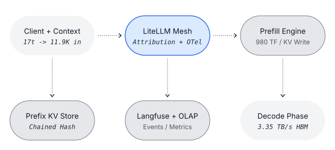
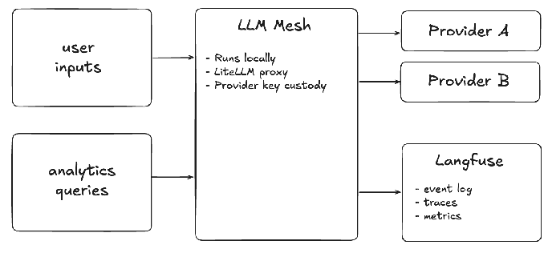

# Module 1: AI Cost Dynamics, GPU Inference Mechanics, Observability & Prefix Caching

> **Associated Recordings:** `01_Week1_Live_Session_2026-10-31_AI_Cost_Dynamics_and_Observability.mp4` (`02:54:29`) & `02_Week1_Office_Hour_2026-11-03_AI_Cost_Dynamics_and_Observability.mp4` (`58:24`)  
> **Whiteboard:** [Week 1 Excalidraw](https://app.excalidraw.com/s/9RJPFj46K45/5JdnYUPzDL5) (`../../Lesson 1_ Foundations.excalidraw` • [Full PNG](../assets/whiteboards/lesson1_foundations_whiteboard.png))  
> **Lab Spec & Code:** [Lab 1 README](../lesson1/lab/README.md) • [`llm-mesh-lab`](../lesson1/lab/llm-mesh-lab/) • [`prompt-caching-lab`](../lesson1/lab/prompt-caching-lab/)



---

## 1. Tokenization & The >500x Context Amplification Effect

### 1.1 BPE Tokenization & Vocabulary Mechanics (`00:44:00`–`00:53:00`)
- Modern frontier models (GPT-4o and newer) use Byte-Pair Encoding (BPE) vocabularies of **~200,000 tokens**.
- **Whiteboard Example:**
  - Raw text: `"AI cost optimization is the practice of systematically reducing the total cost of ownership for AI workloads while preserving the output quality and user experience."`
  - Token IDs: `[15836, 2853, 26329, 374, 279, 6725, 315, 60826, 18189, 279, 2860, ...]`
  - Sub-word splitting: Morphological suffixes split into recurring sub-tokens (e.g., `["descriptive", "-ly"]`).
- **What Does 1 Million Tokens Look Like?**
  - `~750,000` English words (`~0.75` words/token on standard prose, though conversion factors vary across literary corpora like the King James Bible [`~780k` words], *War and Peace*, and *Harry Potter* due to archaic vocabulary and punctuation density—addressed in live Q&A at `00:46:57`).
  - `~4,000` pages of standard printed text, `~200` academic papers, or `~2,000` news articles.

### 1.2 The >500x Agentic Amplification Trace (`00:53:00`–`01:08:00`)
On the Lesson 1 whiteboard, a user asks a 17-token question:
> *"how much seed do I need to plant grass in a circle area with radius 10ft?"*

Behind the scenes, an agentic application bills **11,895 input tokens** and **1,931 output tokens**:
1. **User Input:** `17` tokens (billed as input).
2. **System Prompt:** `675` tokens (e.g., Claude Opus system instructions, billed as input on every step).
3. **Tool Definitions:** `~150` tokens (`{search_kb, calculator, get_product}` schemas, billed as input on every step).
4. **Saved Memory:** `~1,000` tokens (`"user lives in San Francisco, CA"` retrieved from persistent profile store, billed as input).
5. **Retrieved RAG Chunks:** `~2,500` tokens (5 KB passages on Perennial Ryegrass seeding rates of 6–8 lbs per 100 sq ft, billed as input).
6. **Multi-Turn Reasoning & Tool Loop:**
   - Reasoning Turn 1 (`~550` output tokens) + Reasoning Turn 2 (`~750` output tokens) + Reasoning Turn 3 (`~600` output tokens) + Final visible answer (`Area = π × 10² ≈ 314 ft²... yields 18.8 lbs`).
   - Because each reasoning turn re-sends the accumulated prefix + prior tool outputs, total billed tokens reach `11,895` input and `1,931` output:
   $$\text{Total Request Cost (Sonnet \$3/\$15)} = \frac{11,895 \times \$3}{10^6} + \frac{1,931 \times \$15}{10^6} = \$0.0357 + \$0.0290 \approx \$0.0647 \text{ (whiteboard rounded: \$0.052)}$$

---

## 2. Transformer Inference Mechanics: Prefill vs. Decode on GPU Hardware (`01:18:00`–`01:32:00` & `02:41:13`)

### 2.1 Embedding & Multi-Head Self-Attention Math
1. **Input Matrix ($X \in \mathbb{R}^{N \times d}$):** Each of the $N$ input tokens is mapped to a learned embedding vector of dimension $d$ (e.g., $d = 3072$). Semantic proximity holds in $\mathbb{R}^d$ (e.g., $\text{distance}(\text{dog}, \text{puppy}) = 0.05$, $\vec{v}(\text{king}) - \vec{v}(\text{boy}) \approx \vec{v}(\text{queen}) - \vec{v}(\text{girl})$), and self-attention disambiguates polysemous words like `"seed"` across lawn care, sports tournaments, and PRNG seeds.
2. **Projections per Attention Head ($h = 1, \dots, H$, head dimension $d_h = M / H$):**
   - $Q = X W_Q$ (*"What is this token looking for?"*)
   - $K = X W_K$ (*"What does this token have to offer?"*)
   - $V = X W_V$ (*"What does the current token contribute?"*)
   - $\text{Attention}(Q, K, V) = \text{softmax}\left(\frac{Q K^T}{\sqrt{d_h}}\right) V$, concatenated across $H$ heads ($\text{Concat} \in \mathbb{R}^{N \times M}$) and projected via $W_O$ to produce $X'$, repeated across $L$ layers ($L \approx 70\text{--}100$).

### 2.2 Why Output Tokens Cost $3\times$–$5\times$ More: H100 Compute vs. Memory Bandwidth
- **NVIDIA H100 SXM5 Specs (Whiteboard):**
  - **Compute Throughput:** `~980 TFLOPS` (FP16/BF16 Tensor Cores). If 1 token requires `~100B` (`0.1 TFLOP`) arithmetic ops, pure compute could theoretically process $\approx 9,800$ tokens/sec.
  - **HBM Memory Bandwidth:** `~3.35 TB/s` separating off-chip HBM (where model weights and the KV cache live) from on-chip SRAM/registers.

| Phase | Operations Executed | Hardware Bottleneck | UX Metric | Billing Consequence |
| :--- | :--- | :--- | :--- | :--- |
| **Prefill** | Computes $Q, K, V$ for all $N$ input tokens **in parallel** (`GEMM`: matrix-matrix multiply); writes $K, V$ across all $L$ layers into HBM KV Cache. | **Compute-bound** (high arithmetic intensity; 1 weight read from HBM is amortized over $N$ tokens). | **Time to First Token (TTFT)** | Lower per-token cost ($P_{\text{in}}$). |
| **Decode** | Loads prior $K, V$ from HBM; computes $Q, K, V$ for **1 new token** (`GEMV`: matrix-vector multiply); appends new $K, V$ to cache; streams full model weights layer-by-layer per token. | **Memory-bandwidth-bound** (`~3.35 TB/s` HBM read limit; weights loaded for just 1 token per sequence). | **Tokens Per Second (TPS) / ITL** | **$3\times$–$5\times$ higher price** ($P_{\text{out}}$). |

---

## 3. Foundational Telemetry & The LLM Mesh Architecture (`01:35:00`–`02:08:00`)



### 3.1 The Minimum Viable Telemetry Event (5 Schema Layers)
Every request passing through the LLM Gateway should emit a structured event containing five field groups:
1. **Entity Data:** `timestamp`, `request_id`, `trace_id`, `provider`, `model`
2. **Attribution Data:** `user_id`, `app`, `version`, `feature`, `tenant`, `session`, `turn_no`
3. **Metered Data (Normalized Across Providers):**
   - OpenAI (`usage` object): `prompt_tokens`, `completion_tokens`, `total_tokens`
   - Anthropic (`usage` metadata): `input_tokens`, `output_tokens`, `cache_creation_input_tokens`, `cache_read_input_tokens`
   - AWS Bedrock (`response` metadata): `inputTokenCount`, `outputTokenCount`
4. **Performance Data:** `ttft_ms`, `tokens_per_second`, `e2e_latency_ms`
5. **Outcome Data:** `task_status`, `finish_reason`, `retry_count`, `aborted_session`, `user_feedback`

This schema directly answers high-leverage FinOps questions such as:
- *"How much did our `v3.4.6` prompt upgrades decrease total cost of aborted support workflows for Anthropic-bound calls?"*
- *"During the past 28 days, how many aborted sessions for our top 10% user cohort used >10k reasoning tokens and failed to produce their final output?"*

---

## 4. Prompt (Prefix) Caching: Mechanics, Provider Matrix & Chained-Hash Engine (`02:09:00`–`02:54:29`)

### 4.1 Prompt Anatomy for Maximum Prefix Cacheability
Because KV cache blocks are keyed by a **chained cryptographic hash** over fixed-size token blocks ($B$ tokens per block):
$$h_k = \operatorname{Hash}\left(h_{k-1} \mathbin{\Vert} \text{tokens}[(k-1)B : kB]\right)$$
any dynamic token placed near the top of a prompt invalidates **every subsequent block hash**. Always structure prompts from most static to most volatile:

```text
+-------------------------------------------------------------------+
| 1. System Prompt          (Static across all users & sessions)    |  <- Prefix-able
| 2. Tool Schemas           (Static JSON declarations)              |  <- Prefix-able
| 3. Reference Documents    (Static or session-pinned RAG context)  |  <- Prefix-able
| 4. Prior User/Asst Turns  (Appended chronologically per turn)     |  <- Incremental Prefix Hit
+-------------------------------------------------------------------+
| 5. Latest User Prompt     (Dynamic tail -> billed as fresh input) |  <- Uncached Tail
+-------------------------------------------------------------------+
```

### 4.2 Provider Prompt Caching Comparison (Whiteboard Table)
| Provider | Activation Mechanism | Read Discount / Write Fee | TTL & Storage Hierarchy |
| :--- | :--- | :--- | :--- |
| **OpenAI** | Implicit via API (automatic on prefix match $\ge 1024$ tokens) | **~50% discount** on cached reads; no write surcharge | Default: `5–10 min` • Off-peak: `1 hr` • Max: `24 hr` |
| **Anthropic** | Explicit via `cache_control` params + manual breakpoints (or auto-prefix) | **90% discount** on reads ($0.10\times P_{\text{in}}$) + **25% surcharge** on writes ($1.25\times P_{\text{in}}$) | Default: `5 min` • Extended: `1 hr` (`DRAM -> NVMe`) |
| **Google Gemini** | Implicit & Explicit Context Caching | Discounted read rate | Default: `1 hr` (billed per hour of storage beyond default) |
| **DeepSeek** | Implicit on-disk KV cache | Automatic prefix block reuse | Disk-backed multi-turn TTL |
