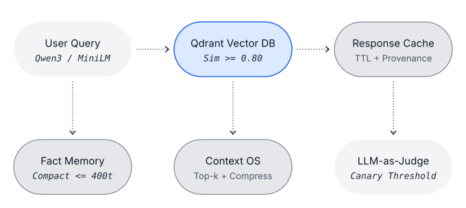
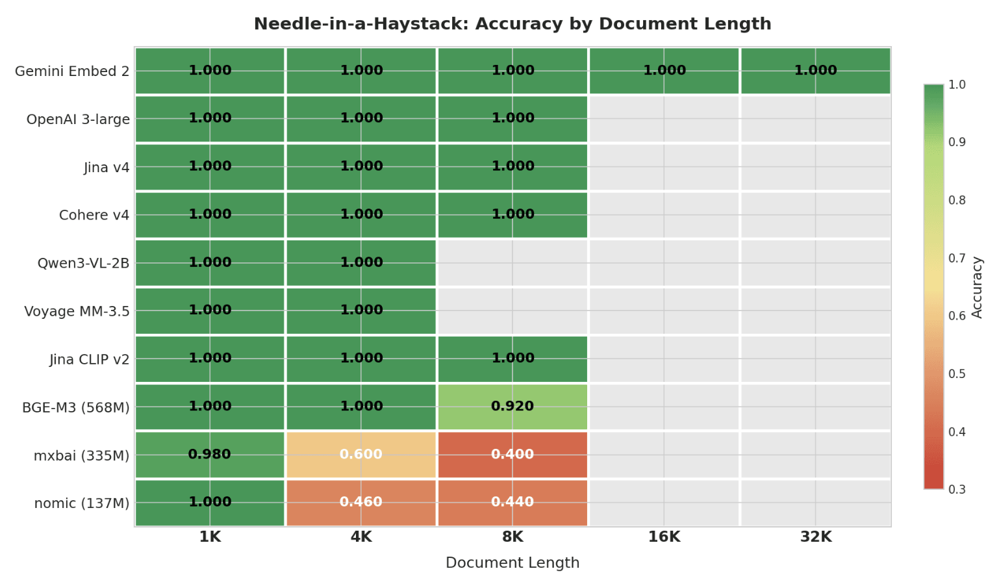

# Module 2: Semantic Caching, Workflow Compilation & Context OS

> **Associated Recordings:** `03_Week2_Live_Session_2026-11-07_Token_Efficiency_Techniques.mp4` (`02:07:44`) & `04_Week2_Office_Hour_2026-11-10_Token_Efficiency_Techniques.mp4` (`22:28`)  
> **Whiteboard:** [Week 2 Excalidraw](https://link.excalidraw.com/l/9RJPFj46K45/5rjUHd25pKl) (`../../Lesson 2_ Caching & Compression.excalidraw` • [Full PNG](../assets/whiteboards/lesson2_caching_compression_whiteboard.png))  
> **Lab Spec & Code:** [Lab 2 README](../lesson2/lab/README.md) • [`rag-lab`](../lesson2/lab/rag-lab/) • [`context-os-lab`](../lesson2/lab/context-os-lab/)



---

## 1. Beyond Prefix Caching: Exact-Match vs. Semantic Caching (`00:08:00`–`00:40:00`)

Prefix caching cuts input KV compute when prompts start **byte-for-byte identically**, but it still invokes the LLM and pays full output token costs on every request. When thousands of users ask semantically equivalent questions (`"What's your return/refund policy?"`, `"Can I return my last purchase?"`, `"I'd like a refund, please"`), **Semantic Caching** intercepts the request inside the LLM Gateway and returns a cached completion (`llm_calls = 0`).



### 1.1 Symmetric vs. Asymmetric Embedding Spaces (`00:25:00`–`00:36:00`)
- **Asymmetric Retrieval Space (Standard RAG):** Embeds a short `query` against a long `document passage`.
- **Symmetric Retrieval Space (Semantic Cache Lookup):** Embeds an incoming `query` against previously cached `queries` (`query-to-query` duplicate detection). Never compare an incoming query vector against cached *answer* vectors.
- **Whiteboard Model Recommendations:**
  - **Self-Hosted Pick:** **`Qwen3-Embedding-0.6B`** (Apache 2.0, instruction-tuned to steer toward duplicate detection, low latency).
  - **Managed API Pick:** **`jina-embeddings-vN`** (supports `task="text-matching"` for symmetric similarity, `~$0.02 / 1M` tokens).
  - **Local Lab Default:** [`sentence-transformers/all-MiniLM-L6-v2`](https://huggingface.co/sentence-transformers/all-MiniLM-L6-v2) (`~90 MB`, 384-d cosine space).
  - **Codebase Retrieval Pick (Office Hour 2):** [`MongoDB/voyage-code-3`](https://huggingface.co/MongoDB/voyage-code-3) & [arXiv:2605.15184v1](https://arxiv.org/html/2605.15184v1).
- **Cost Reality Check:** The embedding model runs on **every request (including misses)** (`~$0.000003`/request at `$0.02/1M` tokens), whereas only cache hits pay back (`$0.011`/request saved).

---

## 2. Selecting What to Cache, Seeding & Canary Quality Control (`00:36:00`–`01:05:00`)

### 2.1 What Is Safe to Cache?
| Good Candidates (Universal, Stable, Self-Contained) | Bad Candidates (User-Specific, Mutating, Real-Time) |
| :--- | :--- |
| `"What's your refund policy?"` | `"What's the status of my refund?"` (requires user order lookup) |
| `"Do you ship internationally?"` | `"Where is my package?"` (stateful per-user tracking) |
| `"How do I reset my password?"` | `"Reset my password"` (side-effectful action) or live election/market queries (`01:55:39`) |

### 2.2 The Opposite-Intent Neighborhood Trap
> *"Cacheability is a property of the entry, but risk is a property of the neighborhood."*

Consider four queries in embedding space:
- `"How do I enable two-factor auth?"` / `"How do I set up two-factor auth?"`
- `"How do I disable two-factor auth?"` / `"How do I turn off two-factor auth?"`

Because they share almost identical lexical tokens, a loose threshold can return the **enable 2FA** instructions to a user trying to **turn off 2FA**. Three mitigations from the whiteboard:
1. **Dynamic Per-Topic Thresholds:** Use a tighter similarity threshold (e.g., `0.90+`) on high-risk topics (security, billing) and a looser threshold (`0.78–0.82`) on low-risk FAQs.
2. **Dense Paraphrase Seeding:** Seed both positive (`Q1 -> A1`) and negative/opposite (`Q2 -> A2`) phrasings so nearest-neighbor Voronoi cells separate cleanly.
3. **Unified Answers:** Write `A1` to cover both enabling and disabling 2FA (`"To toggle 2FA on or off, go to Settings > Security..."`) so a neighborhood collision still answers the user's question!

### 2.3 Offline Seeding Pipeline & Live Canary Monitoring
1. **Offline Seeding (`Raw Query Dump -> Curate`):**
   - Collect $N$ samples over $M$ days of traffic $\to$ **Admission Filter** (strip PII, multi-turn, and user-specific queries) $\to$ **Embed & Cluster** (`HDBSCAN`) $\to$ **Rank by Value**:
     $$\text{Cluster Value} = \left(\text{Token Cost of Response}\right) \times \left(\text{Number of Clustered Queries}\right)$$
   - Curate verified Q&A pairs and set aside a golden evaluation split.
2. **Continuous Miss Mining:** Log cache misses (`vector + original query + distance to nearest cluster`) $\to$ run nightly `HDBSCAN` clustering + LLM-as-Judge filtering to expand the cache.
3. **Provenance-Based Invalidation:** Store metadata alongside every cached response:
   ```yaml
   response: "Refunds must be requested no more than 30 days after purchase..."
   provenance: kb/refund-policy@v7
   ttl: 30d
   ```
   When `kb-updates` or `provider-updates` (model upgrades) fire, invalidate matching provenance tags immediately rather than serving stale answers until TTL expiry.
4. **Live Canary False-Positive Detection:** On `X%` of production cache hits, asynchronously execute the full RAG + LLM workflow in the background and pass `(Cached Response, Full Response)` to an **LLM-as-Judge**. If the canary false-positive rate exceeds `X%`, automatically tighten `similarity_threshold`!

---

## 3. Component & Workflow Caching ("Procedural Memory") (`01:05:00`–`01:18:00`)

When a request requires user-specific data (`"I'd like a refund, please"`), full-response semantic caching cannot be used directly. Instead, cache the **workflow plan** (`Plan Caching` / `Workflow Compilation`):
1. **Step 1 — Retrieve Policy (`Retrieval Cache`):** Cache `"Retrieve refund policy" -> refund_policy_doc`.
2. **Step 2 — Resolve Order (`Tool Schema Cache`):** Cache `"Get user's most recent order" -> get_orders(user_id, sort=recent, limit=1)`.
3. **Step 3 — Apply Policy (`Rule Compiler`):** Compile prose policy rules into deterministic execution:
   - **Option 1:** Reusable Agent **Skills**
   - **Option 2:** **Encoded Decision Tree** (`days_bucket | category | opened | payment -> decision`)
   - **Option 3:** **LLM Writes Code** (compiled once and refreshed only when `sha256(policy)` or `sha256(toolset)` changes):
     ```json
     {
       "intent": "refund_inquiry",
       "plan_version": "v3",
       "compiled_against": { "toolset": "sha256:a41b...", "policy": "sha256:9f2c..." }
     }
     ```
- **Napkin Math:** A 4-step Sonnet (`$3/$15`) refund agent costs **`$0.0571` per request** (`2,550 -> 5,200 -> 8,100 -> 11,400` compounding input tokens across steps) with only prompt caching; compiling the workflow into a cached plan + deterministic rule table cuts cost by >85%.

---

## 4. Context Rot, Compression, Compaction & Memory Hierarchy (`01:18:00`–`02:07:44`)

### 4.1 Context Rot ([Chroma Research](https://www.trychroma.com/research/context-rot))
- Even when frontier models advertise 200K–1M token context windows, accuracy degrades sharply as input length increases (**"Smart Zone" vs. "Dumb Zone"** discussed at `01:26:38`). Keeping context lean improves *both* accuracy and cost.

### 4.2 Extractive Compression vs. Conversation Compaction
| Dimension | Extractive Compression (`compress`) | Conversation Compaction (`compact`) |
| :--- | :--- | :--- |
| **Scope & Trigger** | **Per-request, query-aware**: runs on retrieved RAG chunks (`max_tokens: 120`). | **Per-conversation, query-unaware**: runs when history exceeds `token_budget: 400` (or at 85%–90% context capacity). |
| **Mechanism** | Scores sentences by lexical/semantic overlap with the current query and drops non-overlapping sentences. | Retains system prompt + newest turn suffix; replaces evicted turns with `[compacted: N earlier turns]` or an LLM summary. |
| **Failure Mode** | Can drop a bridging or exception sentence that lacked query keywords. | Drops early turns containing durable entities (e.g., Turn 1 `order_id` or `account_id`), requiring a companion **Fact Store Memory**. |

### 4.3 The Three-Tier Agent Memory Hierarchy & Retrieval Cost Trade-Off
1. **Working Memory:** The active, managed context window sent on the current turn.
2. **Procedural & Episodic Memory:** Snapshots of past actions, execution traces, and learned skills/plans.
3. **Semantic Memory:** Extracted user facts, preferences, and domain knowledge stored in a Vector DB.
- **Why Remembering Everything Backfires (Whiteboard Curve):** As the number of stored memories grows, marginal utility plateaus while retrieval noise and re-ranking cost climb (e.g., querying *"What is Jeremy's favorite color?"* pulls `"green bean casserole"`, `"gray Jeep"`, `"Brown Eyed Girl"`, and `"selected blue on form"`). Only extract **high-utility, durable facts** during compaction.
