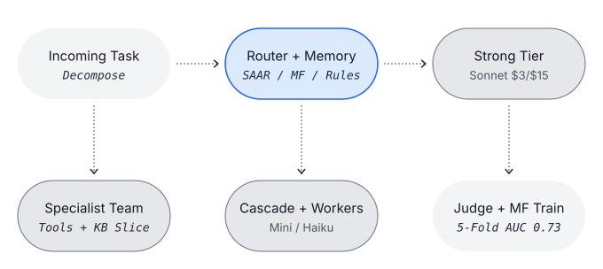
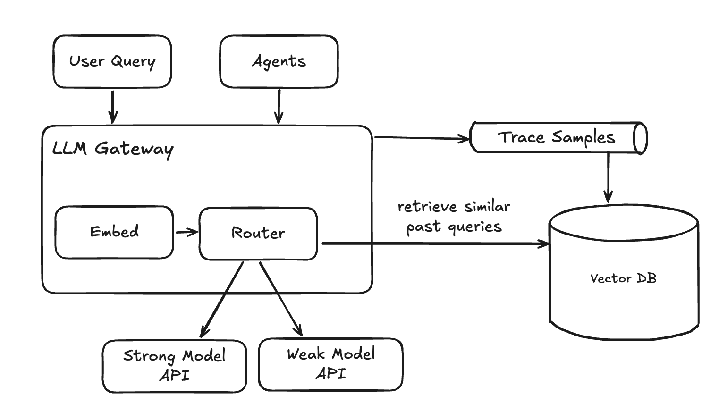
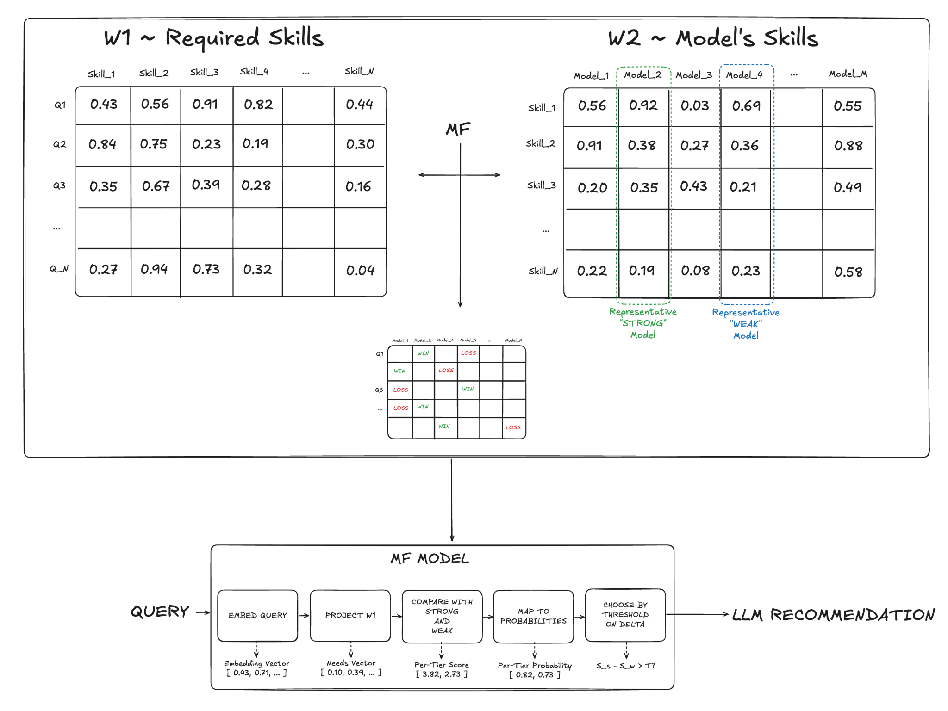

# Module 3: Intelligent Routing, Model Cascades & Agentic Workflow Optimization

> **Associated Recording:** `05_Week3_Live_Session_2026-11-14_Intelligent_Routing_and_Model_Cascades.mp4` (`02:14:42`)  
> **Whiteboard:** [Week 3 Excalidraw](https://app.excalidraw.com/s/9RJPFj46K45/2Kz4F3debdg) (`../../Lesson 3_ Routing and Model Cascades.excalidraw` • [Full PNG](../assets/whiteboards/lesson3_routing_cascades_whiteboard.png))  
> **Lab Spec & Code:** [Lab 3 README](../lesson3/lab/README.md) • [`routing-lab`](../lesson3/lab/routing-lab/) • [`mf-router-lab`](../lesson3/lab/mf-router-lab/)



---

## 1. The Economics of Model Routing & The 3-Step Framework (`00:05:00`–`00:20:00`)

Across the Lab 3 model ladder, unit prices span **20x to 25x**:
- **Weak Tier (`mesh-gpt-mini` / `gpt-4o-mini`):** `$0.15` / `$0.60` per 1M tokens
- **Mid Tier (`mesh-claude-haiku` / `claude-haiku-4-5`):** `$1.00` / `$5.00` per 1M tokens
- **Strong Tier (`mesh-claude-sonnet` / `claude-sonnet-4-6`):** `$3.00` / `$15.00` per 1M tokens

Instead of naively picking "the cheapest model that works," production routing maximizes **Incremental Net Value**:
$$\text{Incremental Net Value} \approx \Delta P(\text{success}) \cdot \text{Value}(\text{success}) - \Delta \text{Cost} - \Delta \text{Latency}$$

### The 3-Step Systematic Routing Framework
1. **Decompose (What are the smaller units of work?):** Static decomposition, dynamic decomposition with feedback, or Chain-of-Thought / Least-to-Most sub-problems.
2. **Determine (What type of work is each unit?):**
   - **Planning:** Complex, high-blast-radius, open-ended $\to$ **Strong Tier**.
   - **Evaluation / Verification:** Well-defined rubric $\to$ **Weak / Mid Tier**.
   - **Recall / Lookup:** Simple extraction over retrieved context $\to$ **Weak Tier**.
3. **Decide (What does "good enough" look like?):** Preference-based routing (RouteLLM) vs. value/threshold-based cascades (FrugalGPT).

---

## 2. Evolution of Routing Architectures (2023–2026) (`00:20:00`–`01:15:00`)



### 2.1 Method 1 & 2: Deterministic Gateway Rules (`mesh-auto`) & Semantic Embedding Routes
- **Gateway Surface Rules ([LiteLLM Auto Routing](https://docs.litellm.ai/docs/proxy/auto_routing)):** Scores prompt length, code markers, and custom regex dimensions (`moneyMath`: `$`, `%`, `"credit"`, `"restocking"`) with **zero model or embedding calls**. Fast and auditable, but brittle to false positives (e.g., routing a simple lookup `"What is the restocking fee on an opened item?"` to Sonnet).
- **Semantic Embedding Routes ([Semantic Router](https://github.com/aurelio-labs/semantic-router)):** Embeds the incoming query and matches it against department utterance centroids (`orders`, `identity`, `billing`, `platform`, `privacy` in `fixtures/routes.json`). Department topic is only a coarse proxy for reasoning difficulty.

### 2.2 Method 3: Model Cascades ([FrugalGPT, arXiv:2305.05176](https://arxiv.org/abs/2305.05176))
- **Mechanism:** Call the **Weak** model first (`cost = w_ans`), run a **Weak Gate** verifier (`cost = w_gate`, total initial cost $w = w_{\text{ans}} + w_{\text{gate}}$), and escalate to the **Strong** model (`cost = s`) only if confidence falls below `cascade.threshold`.
- **Break-Even Escalation Math:**
  $$\mathbb{E}[\text{Cost}_{\text{cascade}}] = w + p \cdot s < s \iff p < 1 - \frac{w}{s}$$
  When $w \ll s$ (e.g., $w / s \approx 0.05$), the cascade saves money up to $p \approx 95\%$ escalation rate, though escalated queries pay $w + s$ and suffer double latency.

### 2.3 Method 4: Preference-Based Routing & Matrix Factorization ([RouteLLM, arXiv:2406.18665](https://arxiv.org/abs/2406.18665))



- **Latent Skill Factorization Intuition (`00:37:00`–`00:52:00`):**
  - Imagine a hidden skill space of dimension $d_{\text{model}} = 128$ (e.g., `Skill_1 = temporal arithmetic`, `Skill_2 = multi-clause policy synthesis`, `Skill_3 = code generation`).
  - Matrix $W_1$ maps each prompt embedding $e(p) \in \mathbb{R}^{1536}$ into the **Required Skills** vector $W e(p) \in \mathbb{R}^{128}$.
  - Matrix $W_2$ ($P[m] \in \mathbb{R}^{128}$) represents each **Model's Skill Profile**.
  - The bilinear scoring function computes the logit for model $m$ on prompt $p$:
    $$s(m, p) = w^T \left( \frac{P[m]}{\|P[m]\|_2} \odot (W e(p) + b) \right)$$
  - The probability that the strong model wins a head-to-head battle is:
    $$P(\text{strong wins} \mid p) = \sigma\big(s(\text{strong}, p) - s(\text{weak}, p)\big)$$
- **Productionizing RouteLLM with Shadow Traffic (`Lesson 3` Whiteboard):**
  1. **LLM Gateway** serves live traffic and writes `Prompt Logs`.
  2. Sampled queries generate asynchronous **Shadow Answers** across candidate models (`Model X_M`, `Model X_N`).
  3. **Label Training Data:** `95%` scored automatically by **LLM-as-Judge** + `5%` audited by **Humans**.
  4. **Periodic Retraining:** Retrain $W, P, w$ after every $X$ new labeled battles and recalibrate threshold (`calibrate.py --strong 0.30`). On MT-Bench, the MF router retains **~95% of Strong quality while cutting cost by ~85%** (sending only ~14% of queries to Strong).

### 2.4 Method 5: [vLLM Semantic Router & Mixture of Models](https://vllm.ai/blog/2026-07-21-vllm-sr-new-chapter-mom) (`01:00:00`–`01:12:00`)
- Exposes a unified **Mixture of Models** under one logical identity, combining semantic clustering, difficulty estimation, rules, preference routing, and cascades.
- **Why Routing Is Still an Open Research Problem ([arXiv:2602.03478](https://arxiv.org/pdf/2602.03478)):** As mid-tier models converge toward frontier quality on routine benchmarks, static routers trained on older Chatbot Arena distributions underperform unless calibrated on **in-domain failure modes**.

---

## 3. Agentic Workflow Optimization & Session-Aware Routing (`01:15:00`–`02:14:42`)

### 3.1 Planning Paradigms: CoT vs. Least-to-Most vs. ReAct vs. ReWOO vs. Self-Reflection
1. **Chain of Thought (CoT) vs. Least-to-Most (LtM):** CoT reasons in a single pass, whereas LtM decomposes `"Alice had 4 boxes with 5 widgets..."` into sequential sub-questions—which naively re-sends the growing prompt 3 times unless sub-steps are isolated.
2. **ReAct (`mode="react"`):** Alternates `Reasoning -> Action (Tool Call) -> Observation` in one growing `messages` list, paying Strong-tier input prices to re-read refund policies while answering rate-limit questions.
3. **Four Architectural Fixes for Agent Token Bloat (Whiteboard):**
   - **ReWOO (Reasoning Without Observation):** Generates the full symbolic tool-call plan upfront so workers execute without intermediate observation loops.
   - **Plan-and-Execute (`mode="plan"`):** Calls the Strong model **once** to decompose the ticket into isolated sub-tasks, executes each step on Weak workers in fresh contexts, and stitches the final response on Weak.
   - **Self-Reflection Loop:** Separates `Actor LLM (ReAct)` $\leftrightarrow$ `Short-Term Memory` $\leftrightarrow$ `Evaluator LLM` $\leftrightarrow$ `Self-Reflection LLM` $\to$ `Long-Term Memory` (high accuracy via inference-time scaling, but must be bounded by `max_iterations` and token budgets).
   - **Hierarchical (`supervisor="llm"`) vs. Decentralized/Vector (`supervisor="vector"`) Specialist Teams:** Routes sub-tasks to domain specialists (`orders` [weak], `billing` [strong $\to$ mid], `platform` [mid]), each carrying only its own 2–3 tools and 2 KB docs instead of all 6 tools and 8 docs.

### 3.2 vLLM Session-Aware Agentic Routing (SAAR) & Router Memory (`01:55:00`–`02:13:00`)
Why does naive per-turn routing fail inside an active coding or support agent session?
1. **Broken Tool-Loop Continuity:** If Turn $t$ routes to Model A which emits a tool call, routing Turn $t+1$ (the tool output) to Model B breaks reasoning continuity and tool formatting assumptions.
2. **Destroyed Provider Prefix Cache:** Switching from Anthropic (`claude-sonnet-4-6`) to OpenAI (`gpt-4o-mini`) mid-session forfeits the 90% KV cache read discount on the 20,000-token session prefix!
- **The Fix — Router Memory (SAAR):** The router maintains session state (`last_physical_model`, `active_tool_loop`, `session_phase`, `cached_prefix_host`), pinning tool-execution loops to the model that initiated them and only switching models at clean phase boundaries—achieving **~80% cost savings** on complex production workflows.

### 3.3 Post-Session Enterprise Memory Pipeline (`Lesson 3` Whiteboard Bottom Panel)
```text
[Agent Orchestration / Tools / Logs] ---> [Data Warehouse (DWH)]
                                                |
                                                v
                       [Extraction Pipeline: 1. Segment by session
                                             2. Filter superfluous entities
                                             3. Distill & Normalize core facts]
                                                |
         +----------------------+---------------+---------------+----------------------+
         v                      v                               v                      v
   [Vector DB]          [Keyword Index]                 [Entity Graph]        [.md / .txt Files]
 (Semantic Recall)     (Exact ID Lookup)             (Relational Memory)     (User/Topic/Procedures)
```
Updates are committed via three cadences: **In-Session Commit** (critical user preferences), **Post-Session Job** (session summary & fact extraction), and **Periodic Reconciliation** (deduplicating and pruning stale facts).
